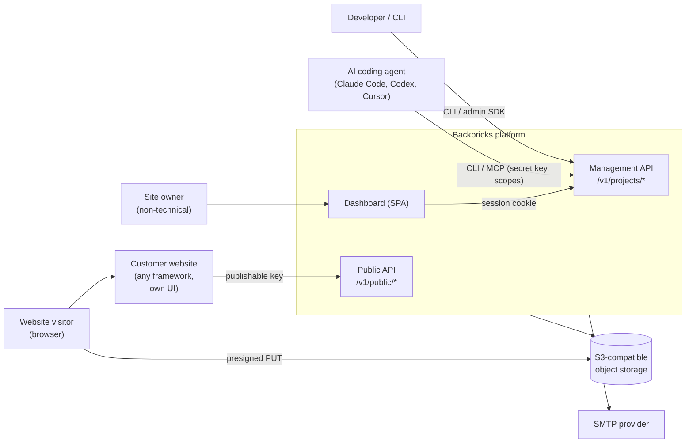
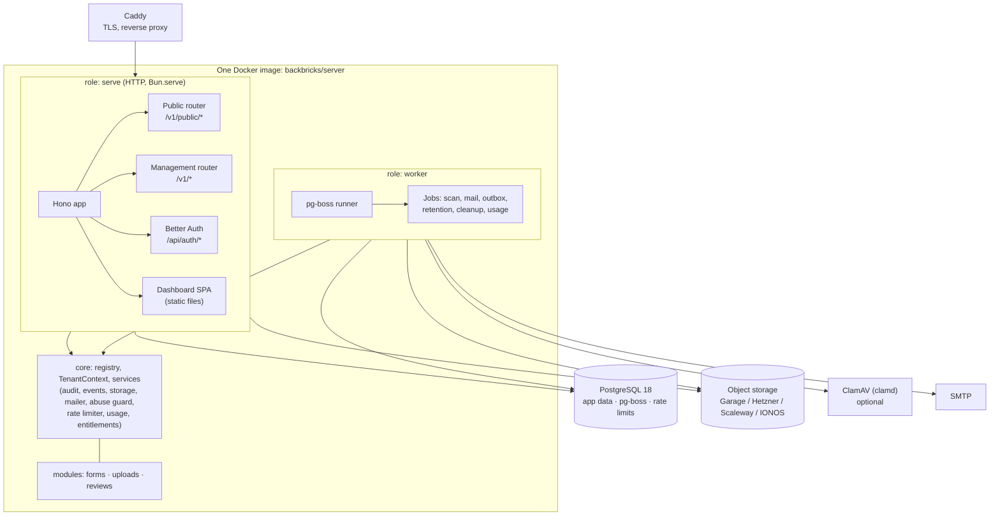
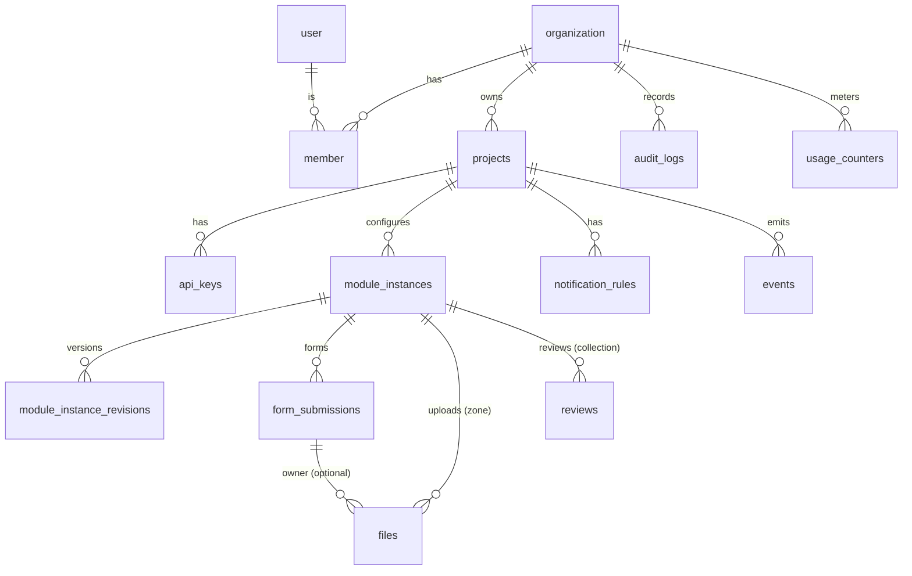
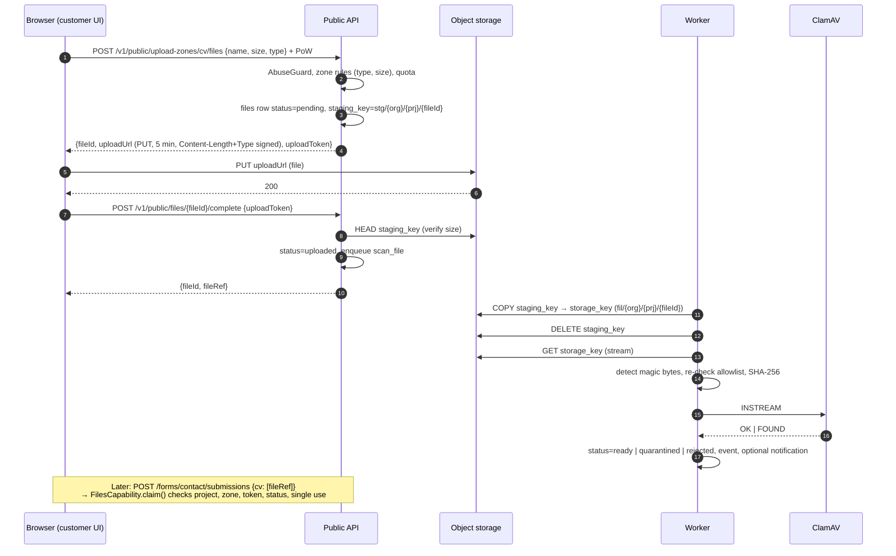
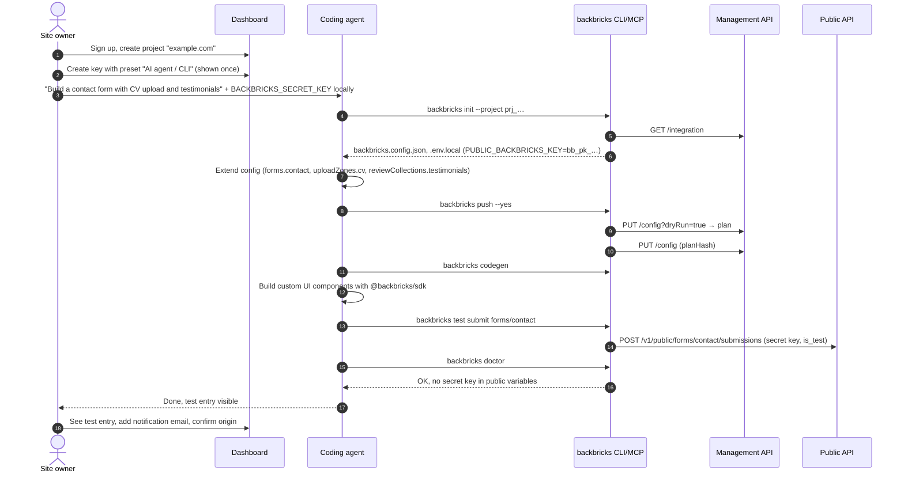
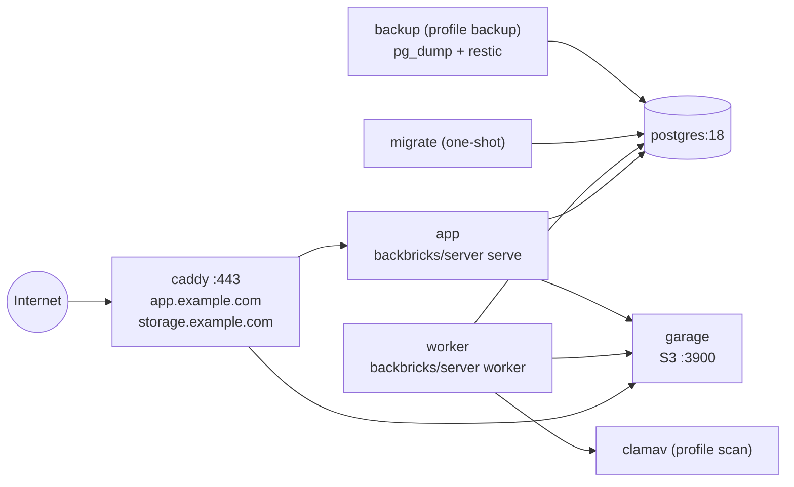

# Backbricks – Architecture

> **Backbricks** is an open-source, self-hostable headless platform that gives any website managed backend features (forms, file uploads, reviews), integrated by AI coding agents via API, SDK, CLI and MCP, and managed by non-technical site owners in a dashboard. A managed EU cloud follows after the open-source 1.0.
>
> *Backbricks are the backend bricks of a website: pick the ones you need (forms, uploads, reviews, …) and build any frontend on top. Backbricks carries the functionality; the website keeps its own look.*
>
> **Status:** Architecture v1 · November 2026
> **Naming:** packages `@backbricks/*`, CLI `backbricks`, key prefixes `bb_pk_` / `bb_sk_`, config file `backbricks.config.json`. Project domain: `backbricks.app`.
> **Authority:** This document is the source of truth for implementation. Deviations are recorded as ADRs in `docs/adr/`. Non-negotiable engineering rules and invariants live in `/AGENTS.md`.

---

## 0. Key decisions at a glance

| # | Decision | Choice | Rationale |
|---|---|---|---|
| 1 | System style | **Modular monolith**, one Docker image, two process roles (`serve`, `worker`) | Fewest moving parts, simple self-hosting, one deployment |
| 2 | Language / runtime | **TypeScript 7, Bun** (runtime, package manager, test runner, bundler) | Existing expertise, one toolchain, fast DX. Node.js is kept only for Playwright and for compatibility tests of published packages |
| 3 | Tooling | **mise** (tool versions + tasks), **Turborepo** (task graph + cache), **oxlint** (type-aware) + **oxfmt**, **lefthook** (pre-push) | Fast, reproducible, one command to set up |
| 4 | HTTP framework | **Hono** on `Bun.serve` + `@hono/zod-openapi` | Zod schemas give validation, OpenAPI and types from one source |
| 5 | Dashboard | **React SPA (Vite)**, TanStack Router/Query, **shadcn/ui**, Tailwind v4, served statically by the API process | No SEO/SSR needs behind a login; one process |
| 6 | Database | **PostgreSQL 18**, Drizzle ORM (`pg` driver), SQL migrations | The only stateful core dependency, also used for queue and rate limits |
| 7 | Background jobs | **pg-boss** | No Redis required |
| 8 | File storage | **S3-compatible** behind an interface; self-host default **Garage** | MinIO community edition entered maintenance mode in late 2025 and has since been archived |
| 9 | Dashboard auth | **Better Auth** (email/password, organization plugin; later OAuth provider for remote MCP) | Self-hostable, Postgres, roles and invitations built in |
| 10 | Multi-tenancy | Shared DB/schema, `organization_id` + `project_id` on every row, `withTenant()` access layer; **Postgres RLS as second line of defense** (cloud phase) | Cheap, simple, can be hardened later without data migration |
| 11 | Public abuse protection | Publishable key + rate limits + honeypot + **self-hosted proof-of-work (ALTCHA protocol)** + quotas | No third-party captcha, privacy-friendly |
| 12 | Uploads | Presigned **PUT** directly to object storage, signed size/type, **copy-then-scan** (ClamAV optional), private by default | The app never proxies large files; no overwrite-after-scan gap |
| 13 | Agent integration | REST + OpenAPI, SDK, CLI with **config-as-code** (`backbricks.config.json`), **MCP server over stdio inside the CLI**; remote MCP with OAuth later | Simple, safe, works immediately in Claude Code / Codex / Cursor |
| 14 | Local development | **Docker Compose** for the whole dev environment (infra + app services); the **same compose file** is used by CI | One definition of the environment, no drift |
| 15 | License | **AGPL-3.0-only** for server/dashboard/modules, **MIT** for SDK/CLI/examples/skills, **DCO** for contributions, trademark policy for the name | Protects against cloud resale; zero license friction for customer websites |
| 16 | Self-host vs. cloud | **Same code**, `DEPLOYMENT_MODE=self_hosted\|cloud`; differences only via `Entitlements`/`Billing` interfaces | No fork, no feature lock in the core |
| 17 | Priority | **Open-source release first** (milestones M0–M6), managed cloud afterwards (C1–C3) | Validates the product and builds community before operating costs |
| 18 | Module selection | **Every module is optional**: `BACKBRICKS_MODULES` enables any subset at runtime; required infrastructure is derived from the enabled modules (e.g. object storage only with Uploads) | Self-hosters deploy only the stack they need; one image, enabling a module later needs no rebuild (§C.7) |

---

## 1. Assumptions and open points

**Assumptions** (re-evaluate if they stop holding):

- A1: Small initial load (< 100 organizations, < 1M submissions/month). One app instance plus one worker is enough.
- A2: One project equals one website. Test/live environments per project are out of MVP scope; test data is flagged with `is_test`.
- A3: Max file size in the MVP: 100 MB per file (single PUT). Multipart uploads come later.
- A4: Dashboard languages: English and German from day one (i18n keys); more later.
- A5: Review ratings use a 1–5 scale by default, configurable up to 10.
- A6: The website operator is the GDPR controller; the managed cloud acts as processor. Self-hosters are their own controllers and processors.

**Deferred decisions** (see section J): billing provider, remote MCP with OAuth, webhook delivery, per-project permissions, application-level field encryption, final legal review of the license setup.

**Out of scope for v1:** visual website builder; drag-and-drop form designer with its own design engine; general-purpose CRM or CMS; auth-as-a-service for website end users; workflow automation builder; third-party module marketplace; email marketing infrastructure; payments/subscriptions for connected websites; native mobile SDKs; enterprise SSO.

**After v1:** candidate modules (live chat, booking, polls, feature voting, surveys, analytics, cookie consent, job postings, gallery, product catalog, protected content, …) and the platform capabilities they need are listed in `docs/MODULES.md`.

---

## A. Architecture

### A.1 Recommendation: modular monolith

One TypeScript codebase with clearly separated domain modules (`forms`, `uploads`, `reviews`) on a shared `core`. Shipped as **one** Docker image (`oven/bun` base) that starts in one of these roles:

- `serve`: HTTP (public API, management API, Better Auth routes, static dashboard)
- `worker`: pg-boss jobs (malware scan, email, outbox dispatcher, retention, cleanup, usage aggregation)
- `all`: `serve` and `worker` in one process, for the smallest self-hosted setups (two containers: app + Postgres)
- `migrate`: one-shot database migrations
- `setup`: first-run setup (instance admin) for self-hosting

**Why not microservices**

| Criterion | Modular monolith | Microservices |
|---|---|---|
| Services for self-hosting | 4 (app, worker, Postgres, storage) + optional ClamAV, Caddy | 8–15 |
| Cross-module transactions (e.g. submission + file claim) | One DB transaction | Sagas / eventual consistency |
| Operable by a solo founder | Yes | Unrealistic |
| Later extraction | Possible if module boundaries hold | – |

Module boundaries are enforced technically (C.3), which keeps a later extraction (e.g. the scan worker or the public API) possible without paying for it now.

**Why not Next.js:** The dashboard needs no SSR/SEO. The public API needs precise control (per-project CORS, body limits, rate limits, streamed exports, problem-details errors), and the worker is a separate process anyway. Hono + Vite SPA gives **one** Bun process with clear separation. All React/TypeScript/Tailwind knowledge still applies. The marketing and docs site is a separate static Astro app (`apps/www`, see ADR-0001).

### A.2 System context



### A.3 Containers and processes



### A.4 Communication paths

| From → To | Channel | Auth |
|---|---|---|
| Customer website → public API | HTTPS JSON (or `application/x-www-form-urlencoded` for plain HTML forms) | Publishable key (`bb_pk_…`) via `Authorization: Bearer` or `?key=` |
| Browser → object storage | Presigned PUT (5 min, size and type signed) | Signature in URL |
| Dashboard → management API | Same-origin fetch, the same API agents use (dogfooding) | Better Auth session cookie + CSRF header |
| CLI / MCP / backend → management API | HTTPS JSON | Secret key (`bb_sk_…`) with scopes |
| Customer backend → public API | HTTPS JSON | Secret key with `forms:submit` etc. (skips proof-of-work) |
| App → worker | Insert into `events` (outbox) or `pg-boss.send()` in the same transaction | internal |
| Worker → ClamAV | TCP `INSTREAM` | Network isolation |

### A.5 Infrastructure components

| Component | MVP | Required | Self-host default | Cloud |
|---|---|---|---|---|
| App (`serve`) | ✔ | Yes | container | 1 instance (stateless, horizontally scalable later) |
| Worker | ✔ | Yes (own container, or in-process via role `all`) | container (same image) | 1 instance |
| PostgreSQL | ✔ | Yes (the only always-required service) | `postgres:18` | self-operated with PITR or managed in DE |
| Object storage | ✔ | Only if an enabled module needs files (Uploads) | Garage, compose profile `storage` | Hetzner Object Storage (DE) or alternative |
| SMTP | ✔ | Recommended (notifications; without SMTP, invitations fall back to copyable links) | any SMTP | EU SMTP provider |
| ClamAV | ✔ | Optional, only with Uploads (`SCANNER=none\|clamav`) | compose profile `scan` | on |
| Reverse proxy/TLS | ✔ | Recommended | Caddy | Caddy |
| Redis | ✘ | No | – | only with measured need |
| CDN for review read API | ✘ | No | – | later (cache headers correct from day one) |

### A.6 MVP vs. later scale

| Topic | MVP | Later (only when needed) |
|---|---|---|
| Instances | 1× serve, 1× worker | n× serve behind a load balancer; workers split by queue |
| Rate limiting | Postgres implementation (UNLOGGED table), memory impl for tests | Redis/Valkey impl behind the same interface |
| Review read API | `Cache-Control` + `ETag`, Postgres query | CDN/edge cache, precomputed aggregates |
| Tenant isolation | `withTenant()` + tests | + Postgres RLS (cloud), schema-per-tenant for enterprise |
| Uploads | Single PUT ≤ 100 MB | Multipart, resumable (tus), image variants |
| MCP | stdio inside the CLI | Remote MCP (`/mcp`, Streamable HTTP, OAuth 2.1) |
| Webhooks | Outbox table as foundation | Delivery with signatures, retries, logs |
| Regions | One EU region (DE) | More EU regions per organization |

---

## B. Data model

### B.1 Principles

1. **Every tenant table** has `organization_id` and, if project-scoped, `project_id`. Exceptions: Better Auth tables and global system tables.
2. **IDs** are TypeIDs stored as `text` (prefix + UUIDv7 in base32, e.g. `sub_01jc9…`): sortable by time, self-describing in logs, and agents notice immediately when they pass the wrong kind of ID. Generated in the application.
3. **Module-specific tables** instead of a universal `records` table. User-defined fields live as `jsonb` inside module tables; fixed semantics (rating, moderation status, file status) are real columns with indexes.
4. **Personal data is hard-deleted** (no soft delete). Soft delete only for configuration objects (projects) where restore makes sense.
5. **`expires_at`** on every record with personal data, derived from the retention period; a daily job deletes.
6. **IP addresses are never stored in clear text**, only as `HMAC-SHA256(ip, daily rotating key)` for rate limiting and abuse detection.
7. **Configuration is versioned** (`config_version`); every change creates a revision. Submissions record the version they were validated against.

### B.2 Entities and relationships



Hierarchy: **Organization → Project (= website) → Module instance (form `contact`, upload zone `cv`, review collection `testimonials`) → Records**.

### B.3 PostgreSQL schema (first version)

Better Auth tables (`user`, `session`, `account`, `verification`, `organization`, `member`, `invitation`) are generated by the Better Auth CLI and committed into our migration history. All tables below belong to the platform. (Validated against PostgreSQL 16; target is 18.)

```sql
-- =========================================================
-- Core: projects and credentials
-- =========================================================
CREATE TABLE projects (
  id               text PRIMARY KEY,                       -- prj_…
  organization_id  text NOT NULL REFERENCES organization(id) ON DELETE CASCADE,
  name             text NOT NULL,
  slug             text NOT NULL,
  allowed_origins  text[] NOT NULL DEFAULT '{}',            -- e.g. {https://example.com}
  settings         jsonb NOT NULL DEFAULT '{}',             -- timezone, locale, defaults
  created_at       timestamptz NOT NULL DEFAULT now(),
  updated_at       timestamptz NOT NULL DEFAULT now(),
  deleted_at       timestamptz,
  UNIQUE (organization_id, slug)
);

CREATE TABLE api_keys (
  id               text PRIMARY KEY,                       -- key_…
  organization_id  text NOT NULL REFERENCES organization(id) ON DELETE CASCADE,
  project_id       text NOT NULL REFERENCES projects(id) ON DELETE CASCADE,
  kind             text NOT NULL CHECK (kind IN ('publishable','secret')),
  name             text NOT NULL,
  lookup_hash      bytea NOT NULL UNIQUE,                  -- sha256(token)
  display_prefix   text NOT NULL,                          -- "bb_sk_7Hq2…" (display only)
  public_token     text UNIQUE,                            -- publishable keys only; may be shown again
  scopes           text[] NOT NULL DEFAULT '{}',
  created_by       text REFERENCES "user"(id) ON DELETE SET NULL,
  last_used_at     timestamptz,
  expires_at       timestamptz,
  revoked_at       timestamptz,
  created_at       timestamptz NOT NULL DEFAULT now(),
  CHECK ((kind = 'publishable') = (public_token IS NOT NULL))
);
CREATE INDEX api_keys_project_idx ON api_keys (project_id) WHERE revoked_at IS NULL;

-- =========================================================
-- Generic: module instances and configuration revisions
-- =========================================================
CREATE TABLE module_instances (
  id               text PRIMARY KEY,                       -- mod_…
  organization_id  text NOT NULL,
  project_id       text NOT NULL REFERENCES projects(id) ON DELETE CASCADE,
  module_type      text NOT NULL,                          -- 'forms' | 'uploads' | 'reviews' | …
  key              text NOT NULL CHECK (key ~ '^[a-z0-9][a-z0-9-]{0,62}$'),
  name             text NOT NULL,
  status           text NOT NULL DEFAULT 'active' CHECK (status IN ('active','paused','archived')),
  config           jsonb NOT NULL,                         -- validated by ModuleDefinition.configSchema
  config_version   integer NOT NULL DEFAULT 1,             -- revision of this instance
  module_version   integer NOT NULL,                       -- version of the module's config format
  created_at       timestamptz NOT NULL DEFAULT now(),
  updated_at       timestamptz NOT NULL DEFAULT now(),
  UNIQUE (project_id, module_type, key)
);

CREATE TABLE module_instance_revisions (
  id               text PRIMARY KEY,                       -- rvn_…
  organization_id  text NOT NULL,
  project_id       text NOT NULL,
  instance_id      text NOT NULL REFERENCES module_instances(id) ON DELETE CASCADE,
  config_version   integer NOT NULL,
  config           jsonb NOT NULL,
  actor_type       text NOT NULL,                          -- user | api_key | mcp | system
  actor_id         text,
  created_at       timestamptz NOT NULL DEFAULT now(),
  UNIQUE (instance_id, config_version)
);

-- =========================================================
-- Module: forms
-- =========================================================
CREATE TABLE form_submissions (
  id               text PRIMARY KEY,                       -- sub_…
  organization_id  text NOT NULL,
  project_id       text NOT NULL,
  instance_id      text NOT NULL REFERENCES module_instances(id) ON DELETE CASCADE,
  config_version   integer NOT NULL,
  data             jsonb NOT NULL,                         -- validated, normalized fields
  status           text NOT NULL DEFAULT 'open' CHECK (status IN ('open','done')),
  read_at          timestamptz,
  spam_verdict     text NOT NULL DEFAULT 'ok' CHECK (spam_verdict IN ('ok','suspect','spam')),
  spam_reasons     text[] NOT NULL DEFAULT '{}',
  is_test          boolean NOT NULL DEFAULT false,
  subject_email    text,                                   -- normalized, for GDPR access/erasure
  source           jsonb NOT NULL DEFAULT '{}',            -- origin, path, ua_family, ip_hash
  search_vector    tsvector,
  created_at       timestamptz NOT NULL DEFAULT now(),
  updated_at       timestamptz NOT NULL DEFAULT now(),
  expires_at       timestamptz
);
CREATE INDEX form_submissions_list_idx    ON form_submissions (instance_id, created_at DESC);
CREATE INDEX form_submissions_project_idx ON form_submissions (project_id, created_at DESC);
CREATE INDEX form_submissions_search_idx  ON form_submissions USING gin (search_vector);
CREATE INDEX form_submissions_subject_idx ON form_submissions (project_id, subject_email) WHERE subject_email IS NOT NULL;
CREATE INDEX form_submissions_expiry_idx  ON form_submissions (expires_at) WHERE expires_at IS NOT NULL;

-- =========================================================
-- Module: uploads
-- =========================================================
CREATE TABLE files (
  id                 text PRIMARY KEY,                     -- file_…
  organization_id    text NOT NULL,
  project_id         text NOT NULL,
  instance_id        text NOT NULL REFERENCES module_instances(id) ON DELETE CASCADE, -- upload zone
  status             text NOT NULL CHECK (status IN
                       ('pending','uploaded','scanning','ready','quarantined','rejected')),
  staging_key        text NOT NULL UNIQUE,                 -- target of the presigned URL
  storage_key        text UNIQUE,                          -- final copy, never writable via URL
  original_name      text NOT NULL,
  declared_mime      text,
  detected_mime      text,
  size_bytes         bigint NOT NULL CHECK (size_bytes > 0),
  sha256             bytea,
  scan               jsonb,                                -- {engine, result, signature, scanned_at}
  upload_token_hash  bytea NOT NULL,                       -- authorizes complete + claim
  owner_type         text,                                 -- 'form_submission' | 'review' | NULL
  owner_id           text,
  metadata           jsonb NOT NULL DEFAULT '{}',          -- client-provided, validated and bounded
  is_test            boolean NOT NULL DEFAULT false,
  subject_email      text,
  created_at         timestamptz NOT NULL DEFAULT now(),
  uploaded_at        timestamptz,
  expires_at         timestamptz
);
CREATE INDEX files_list_idx    ON files (instance_id, created_at DESC);
CREATE INDEX files_owner_idx   ON files (owner_type, owner_id) WHERE owner_id IS NOT NULL;
CREATE INDEX files_orphan_idx  ON files (created_at) WHERE owner_id IS NULL;
CREATE INDEX files_expiry_idx  ON files (expires_at) WHERE expires_at IS NOT NULL;

-- =========================================================
-- Module: reviews
-- =========================================================
CREATE TABLE reviews (
  id                 text PRIMARY KEY,                     -- rev_…
  organization_id    text NOT NULL,
  project_id         text NOT NULL,
  instance_id        text NOT NULL REFERENCES module_instances(id) ON DELETE CASCADE, -- collection
  rating             smallint NOT NULL CHECK (rating BETWEEN 1 AND 10),
  title              text,
  body               text,
  author_name        text NOT NULL,
  author_email       text,                                 -- never public
  public_fields      jsonb NOT NULL DEFAULT '{}',          -- e.g. company, role (public per config)
  private_fields     jsonb NOT NULL DEFAULT '{}',
  moderation_status  text NOT NULL DEFAULT 'pending' CHECK (moderation_status IN ('pending','approved','rejected')),
  published_at       timestamptz,
  moderated_by       text,
  moderated_at       timestamptz,
  spam_verdict       text NOT NULL DEFAULT 'ok' CHECK (spam_verdict IN ('ok','suspect','spam')),
  is_test            boolean NOT NULL DEFAULT false,
  source             jsonb NOT NULL DEFAULT '{}',
  created_at         timestamptz NOT NULL DEFAULT now(),
  updated_at         timestamptz NOT NULL DEFAULT now(),
  expires_at         timestamptz,
  CHECK (published_at IS NULL OR moderation_status = 'approved')
);
CREATE INDEX reviews_public_idx ON reviews (instance_id, published_at DESC)
  WHERE moderation_status = 'approved' AND published_at IS NOT NULL AND is_test = false;
CREATE INDEX reviews_queue_idx  ON reviews (instance_id, moderation_status, created_at DESC);

-- =========================================================
-- Platform: events (outbox), audit, notifications, usage
-- =========================================================
CREATE TABLE events (
  id               text PRIMARY KEY,                       -- evt_…
  organization_id  text NOT NULL,
  project_id       text,
  type             text NOT NULL,                          -- 'forms.submission.created'
  subject_type     text,
  subject_id       text,
  payload          jsonb NOT NULL DEFAULT '{}',            -- minimal, NO full personal content
  created_at       timestamptz NOT NULL DEFAULT now(),
  dispatched_at    timestamptz
);
CREATE INDEX events_pending_idx ON events (created_at) WHERE dispatched_at IS NULL;

CREATE TABLE audit_logs (
  id               text PRIMARY KEY,                       -- aud_…
  organization_id  text NOT NULL,
  project_id       text,
  actor_type       text NOT NULL CHECK (actor_type IN ('user','api_key','mcp','system')),
  actor_id         text,
  actor_label      text,                                   -- email / key name at the time of action
  action           text NOT NULL,                          -- 'forms.instance.updated', 'files.downloaded', 'data.exported'
  target_type      text,
  target_id        text,
  changes          jsonb,                                  -- config diffs, never submission content
  ip_hash          bytea,
  request_id       text,
  created_at       timestamptz NOT NULL DEFAULT now()
);
CREATE INDEX audit_logs_org_idx ON audit_logs (organization_id, created_at DESC);

-- Audit logs are append-only for the app role
CREATE FUNCTION audit_logs_immutable() RETURNS trigger LANGUAGE plpgsql AS $$
BEGIN
  IF current_setting('app.allow_audit_purge', true) IS DISTINCT FROM 'on' THEN
    RAISE EXCEPTION 'audit_logs are append-only';
  END IF;
  RETURN OLD;
END $$;
CREATE TRIGGER audit_logs_no_update BEFORE UPDATE OR DELETE ON audit_logs
  FOR EACH ROW EXECUTE FUNCTION audit_logs_immutable();

CREATE TABLE notification_rules (
  id               text PRIMARY KEY,                       -- ntf_…
  organization_id  text NOT NULL,
  project_id       text NOT NULL REFERENCES projects(id) ON DELETE CASCADE,
  instance_id      text REFERENCES module_instances(id) ON DELETE CASCADE, -- NULL = all instances
  event_type       text NOT NULL,
  channel          text NOT NULL DEFAULT 'email' CHECK (channel IN ('email')),
  recipients       text[] NOT NULL,
  include_content  boolean NOT NULL DEFAULT false,         -- privacy by default
  enabled          boolean NOT NULL DEFAULT true,
  created_at       timestamptz NOT NULL DEFAULT now(),
  updated_at       timestamptz NOT NULL DEFAULT now()
);

CREATE TABLE usage_counters (
  organization_id  text NOT NULL,
  project_id       text NOT NULL,
  metric           text NOT NULL,                          -- 'forms.submissions', 'uploads.bytes_ingested', …
  period           date NOT NULL,                          -- first day of month
  value            bigint NOT NULL DEFAULT 0,
  PRIMARY KEY (organization_id, project_id, metric, period)
);

-- =========================================================
-- Technical helper tables
-- =========================================================
CREATE TABLE idempotency_keys (
  project_id       text NOT NULL,
  key              text NOT NULL,
  request_hash     bytea NOT NULL,
  response_status  integer NOT NULL,
  response_body    jsonb NOT NULL,
  created_at       timestamptz NOT NULL DEFAULT now(),
  PRIMARY KEY (project_id, key)
);

CREATE UNLOGGED TABLE rate_limit_buckets (
  bucket           text PRIMARY KEY,                       -- "ip:<hash>:mod_…:60"
  count            integer NOT NULL,
  window_start     timestamptz NOT NULL
);

CREATE TABLE pow_challenges_used (
  signature        text PRIMARY KEY,                       -- proof-of-work replay protection
  expires_at       timestamptz NOT NULL
);

CREATE TABLE system_settings (
  key              text PRIMARY KEY,                       -- 'setup_completed', 'signup_policy', …
  value            jsonb NOT NULL,
  updated_at       timestamptz NOT NULL DEFAULT now()
);
```

### B.4 Generic vs. module-specific

| Generic (core) | Module-specific |
|---|---|
| `projects`, `api_keys`, `module_instances`, `module_instance_revisions` | `form_submissions` |
| `events`, `audit_logs`, `notification_rules`, `usage_counters` | `files` |
| `idempotency_keys`, `rate_limit_buckets`, `pow_challenges_used`, `system_settings` | `reviews` |

**Rule of thumb:** whatever every module needs in the same shape (configuration, versioning, audit, events, notifications, usage) is generic. Anything with its own semantics, indexes or lifecycle is module-specific. A universal EAV/`records` table is deliberately **not** built; that road leads to a no-code database product.

### B.5 Migrations and schema versioning

- **One migration history** (`packages/db/migrations/*.sql`), generated with `drizzle-kit generate`, reviewed by hand and committed. Module tables are defined in module packages but migrated centrally (no ordering problems).
- **Forward-only** in production. Breaking changes follow *expand → migrate → contract* across two releases.
- `migrate` holds a Postgres advisory lock. In compose it runs as a one-shot service before `serve`/`worker`.
- **Module config formats:** `module_version` per instance. When a module changes its config format it ships `migrateConfig(fromVersion, config)`; configs are migrated lazily on read, and a job migrates all instances after deployment.
- **Form schema evolution:** every change creates `config_version + 1` and a revision. Submissions store `config_version`; the dashboard renders each submission with the field definitions of its version and shows unknown/removed fields under "Additional data". CSV export uses the union of all fields.

### B.6 Tenant isolation in the data layer

- **Access layer:** every request creates a `TenantContext { organizationId, projectId?, principal, scopes }`. Tenant tables are accessed only through `withTenant(ctx, async (tx) => …)`, which
  1. opens a transaction,
  2. runs `SET LOCAL app.org_id` / `app.project_id` (prepares RLS),
  3. returns repositories whose queries are always scoped by `organization_id`/`project_id`.
- **Resources of other tenants return `404`**, never `403` (no existence leaks).
- **Cloud phase: enable RLS** on all tenant tables:
  ```sql
  ALTER TABLE form_submissions ENABLE ROW LEVEL SECURITY;
  CREATE POLICY tenant_isolation ON form_submissions
    USING (organization_id = current_setting('app.org_id', true)
           AND (current_setting('app.project_id', true) IS NULL
                OR current_setting('app.project_id', true) = ''
                OR project_id = current_setting('app.project_id', true)));
  ```
  The app role has no `BYPASSRLS`; cross-tenant jobs (retention) use a dedicated role.

---

## C. Module architecture

### C.1 Module contract

Each module exports a `ModuleDefinition`. The core knows modules only through this contract.

```ts
// packages/core/src/modules/contract.ts
export interface ModuleDefinition<TConfig = unknown> {
  type: string;                                  // 'forms'
  moduleVersion: number;                         // version of the config format
  displayName: { en: string; de: string };
  resourceName: { singular: string; plural: string }; // 'form'/'forms' → URL segments

  configSchema: z.ZodType<TConfig>;              // validation + JSON Schema for CLI/editors
  defaultConfig(): TConfig;
  templates?: Record<string, { name: string; config: TConfig }>; // "Contact form", "Job application"
  migrateConfig?(fromVersion: number, config: unknown): TConfig;
  validateConfigChange?(prev: TConfig, next: TConfig): ConfigChangeReport; // detects destructive changes

  publicRoutes?(router: PublicRouter): void;     // mounted at /v1/public/{plural}/{key}/…
  adminRoutes?(router: AdminRouter): void;       // mounted at /v1/projects/{projectId}/{plural}/…

  scopes: ScopeDefinition[];                     // e.g. 'forms:submit'
  events: EventDefinition[];                     // e.g. 'forms.submission.created'
  jobs?: JobDefinition[];                        // pg-boss handlers + cron
  provides?: Partial<CapabilityMap>;             // e.g. uploads provides 'files'
  requires?: (keyof CapabilityMap)[];            // hard dependencies on other modules' capabilities
  optional?: (keyof CapabilityMap)[];            // e.g. forms uses 'files' only if uploads is enabled
  infrastructure: InfraRequirement[];            // e.g. uploads: ['storage', { scanner: 'optional' }]; forms: []

  retention: RetentionHandler;                   // purgeExpired(ctx, now), recomputeExpiry(instance)
  privacy: PrivacyHandler;                       // exportSubject(ctx, email), deleteSubject(ctx, email)
  usageMetrics: MetricDefinition[];
  mcpTools?: McpToolDefinition[];                // optional module-specific agent tools
  codegen?(instance: ModuleInstance<TConfig>): TypeScriptDeclaration; // types for SDK/CLI
}
```

### C.2 Registration

Static, no runtime plugins:

```ts
// apps/server/src/modules.ts
import { formsModule } from '@backbricks/module-forms';
import { uploadsModule } from '@backbricks/module-uploads';
import { reviewsModule } from '@backbricks/module-reviews';

export const modules = defineRegistry([uploadsModule, formsModule, reviewsModule]);
```

`defineRegistry` validates at startup: unique types and scopes, satisfied `requires`, no event collisions. The dashboard has a parallel static registry (`apps/web/src/modules/registry.ts`) with nav entries, routes and icons per module.

**Generic features the core provides for every module** (no module code needed):

- Instance CRUD (`GET/POST /v1/projects/{id}/{plural}`, `GET/PATCH/DELETE …/{key}`) incl. config validation, revision, audit log and event
- Viewing and rolling back revisions
- Config-as-code document `GET/PUT /v1/projects/{id}/config` (all instances of all modules)
- JSON Schema export for editor autocompletion
- Notification rules on module events
- Retention cron, GDPR access/erasure via `retention`/`privacy` handlers
- Usage metering

### C.3 Module boundaries and data isolation

- A module imports **only** `@backbricks/core` and its own files (enforced by dependency-cruiser in CI).
- A module reads/writes **only its own tables**, plus the generic core tables through core services, never directly.
- **Cross-module collaboration happens via capabilities.** Example: `forms` needs files; `uploads` provides the `files` capability:
  ```ts
  interface FilesCapability {
    claim(tx: TenantTx, input: { refs: FileRef[]; zoneKey: string; owner: { type: string; id: string }; maxFiles: number }): Promise<ClaimedFile[]>;
    listByOwner(tx: TenantTx, owner: { type: string; id: string }): Promise<FileSummary[]>;
    deleteByOwner(tx: TenantTx, owner: { type: string; id: string }): Promise<void>;
  }
  ```
  `forms` calls `ctx.capabilities.files?.claim(…)` in **the same transaction** that stores the submission.

### C.4 Shared services (injected by the core)

| Service | Responsibility | Implementations |
|---|---|---|
| `db` / `withTenant` | Tenant-bound transactions | Drizzle/Postgres |
| `audit` | Audit entry in the same transaction | Postgres |
| `events` | Outbox insert in the same transaction | Postgres |
| `queue` | Enqueue jobs | pg-boss |
| `storage` | presign PUT/GET, HEAD, copy, delete, stream | S3 (AWS SDK v3) |
| `scanner` | Malware scan of a stream | `none`, `clamav` |
| `mailer` | Templated mail | SMTP (nodemailer); dev: Mailpit |
| `abuseGuard` | Pipeline for public writes | honeypot, PoW (`altcha-lib`), origin, rate limit, heuristics |
| `rateLimiter` | Fixed window / token bucket | Postgres, memory |
| `usage` | Increment counters | Postgres |
| `entitlements` | Check limits/quotas | `unlimited` (self-host), `plans` (cloud) |
| `clock`, `ids` | Testable time, TypeIDs | – |

### C.5 Demonstration: a hypothetical fourth module "Waitlist"

Goal: visitors join a waitlist with email (and an optional referral code) with double opt-in.

```
packages/modules/waitlist/
  src/config.ts        # zod: { doubleOptIn, confirmRedirectUrl, fields, retentionDays }
  src/schema.ts        # Drizzle table waitlist_entries (standard columns + email, status, confirmed_at, referral)
  src/public.ts        # POST /v1/public/waitlists/{key}/entries, GET …/confirm?token=
  src/admin.ts         # list, export, delete (uses core helpers for pagination/CSV)
  src/jobs.ts          # send confirmation mail
  src/privacy.ts       # exportSubject/deleteSubject by email
  src/index.ts         # export const waitlistModule: ModuleDefinition<WaitlistConfig>
apps/web/src/modules/waitlist/   # list + settings pages, registry entry
packages/db/migrations/00xx_waitlist.sql   # generated
apps/server/src/modules.ts       # one line: add waitlistModule
```

**What does not change:** core tables, auth, keys, audit, notifications (rule on `waitlist.entry.confirmed`), CLI (config-as-code learns `waitlists` from the registry), MCP (generic `config_*` tools), SDK (the generic `client.request('waitlists', key, 'entries', body)` works immediately; a typed `waitlists.join()` is optional sugar). That is scenario E.

### C.6 Deliberately not built

- No runtime plugin loading, no marketplace
- No generic workflow engine (notification = rule "event → email"; webhooks later = rule "event → URL")
- No user-defined tables or relations

### C.7 Optional modules and minimal deployments

Every module can be switched on or off per installation. A self-hoster who only needs uploads runs only what uploads needs.

**Mechanism**

- **One image, runtime selection.** All modules ship in the same Docker image; `BACKBRICKS_MODULES=uploads` (comma-separated, default: all) decides which are active. Separate builds per combination are deliberately avoided: one release artifact, and enabling a module later is an env change plus a restart.
- **Filtered registry.** `defineRegistry` registers only enabled modules: their routes, jobs, scopes, events, MCP tools and dashboard navigation. Disabled modules are inert.
- **Dependencies are validated at startup.** A module's hard `requires` must be satisfied by enabled modules, otherwise startup fails with a clear message (`reviews` requires nothing; nothing in v1 hard-requires another module). `optional` capabilities degrade gracefully: without Uploads, the forms field type `file` is unavailable and configs using it are rejected with `capability_unavailable`.
- **Infrastructure is derived, not assumed.** Each module declares `infrastructure` (`storage`, `scanner`, …). The core composes the env schema from the enabled modules: S3 variables are required only if a module needs storage; ClamAV only if Uploads runs with `SCANNER=clamav`. `/readyz` checks only the services that are actually needed.
- **Disabled modules in the API.** Their routes aren't mounted; requests get `404` with code `module_not_enabled` and a hint. `GET /v1/meta` (public) and `GET /v1/projects/{id}/integration` list enabled modules, so the dashboard, SDK, CLI and MCP adapt automatically. Pushing config for a disabled module fails validation.
- **Migrations stay one history.** All tables are created regardless of selection (empty tables cost nothing), so enabling a module later needs no special migration ordering, and disabling one never deletes data.
- **Compose profiles follow the selection.** `deploy/compose` uses profiles per infrastructure (`storage` for Garage, `scan` for ClamAV). A `configure` step (setup CLI) asks which modules to enable and writes `BACKBRICKS_MODULES` plus the matching `COMPOSE_PROFILES` into `.env`.

**Resulting footprints (self-hosted)**

| Enabled modules | Containers | Notes |
|---|---|---|
| Forms and/or Reviews | app (`all`) + postgres (+ caddy) | No object storage, no ClamAV; ~512 MB RAM total |
| Uploads | app + worker + postgres + garage (+ clamav) (+ caddy) | Add ClamAV (~1.5–2 GB RAM) only if scanning is wanted |
| All v1 modules | app + worker + postgres + garage + clamav + caddy | Full setup |

**Cloud:** all modules are enabled at the instance level. Per-organization availability (e.g. by plan) is a separate concern handled by `entitlements`, not by `BACKBRICKS_MODULES`.

---

## D. API, SDK, CLI and MCP

### D.1 Authentication model

| Credential | Format | Used in | May | May not |
|---|---|---|---|---|
| **Publishable key** | `bb_pk_<32 chars base62>` | Public website code | Public API of its project | Management API; reading data (except published reviews) |
| **Secret key** | `bb_sk_<32 chars base62>` | Servers, CLI, MCP, CI | Management API per scopes; public API without PoW | Be used from a browser (detected and blocked) |
| **Session** | Better Auth cookie (`HttpOnly`, `Secure`, `SameSite=Lax`) | Dashboard | Everything per role | Cross-origin requests |
| **OAuth access token** (later) | JWT/opaque | Remote MCP | Granted scopes | – |

**Secret key in browser detection:** a request with a secret key **and** an `Origin` header other than the dashboard origin gets `403 secret_key_exposed`; the incident is audited and owners/admins receive an email recommending rotation.

**Scopes (secret keys):**

| Scope | Meaning | Preset "AI agent / CLI" | Preset "Server integration" | Preset "Data access" |
|---|---|---|---|---|
| `integration:read` | Project info, publishable key, snippets | ✔ | | |
| `config:read` | Read module configs, generate types | ✔ | | |
| `config:write` | Create/change instances (non-destructive) | ✔ | | |
| `config:destructive` | Remove fields/instances that affect data | | | |
| `project:write` | Allowed origins, project settings | | | |
| `test:write` | Test submissions (`is_test=true`) | ✔ | | |
| `stats:read` | Counts without personal data | ✔ | | ✔ |
| `forms:submit`, `uploads:create`, `reviews:submit` | Server-side public operations | | ✔ | |
| `data:read` | Read submissions, files, reviews | | | ✔ |
| `data:write` | Change status, moderate | | | ✔ |
| `data:delete` | Delete records | | | |

Keys are created exclusively in the dashboard (session). No key can create keys.

### D.2 Resource structure and URL conventions

**Base:** `https://api.<domain>/v1` (cloud: dedicated subdomain for the public API; self-host: same host, path `/v1`).

**Public API** (publishable key):

| Method | Path | Purpose |
|---|---|---|
| `GET` | `/v1/public/challenge` | Proof-of-work challenge (ALTCHA format) |
| `GET` | `/v1/public/forms/{formKey}` | Public schema (fields, required, limits, PoW needed?) |
| `POST` | `/v1/public/forms/{formKey}/submissions` | Submit (JSON, or urlencoded with 303 redirect) |
| `POST` | `/v1/public/upload-zones/{zoneKey}/files` | Upload intent → `{fileId, uploadUrl, headers, uploadToken, expiresAt}` |
| `POST` | `/v1/public/files/{fileId}/complete` | Complete upload (with `uploadToken`) |
| `GET` | `/v1/public/review-collections/{key}/reviews` | Published reviews (cursor, `sort=newest\|rating_desc\|rating_asc`, `limit≤50`) |
| `GET` | `/v1/public/review-collections/{key}/stats` | Count, average, distribution |
| `POST` | `/v1/public/review-collections/{key}/reviews` | Submit a review |

**Management API** (session, secret key):

| Area | Paths |
|---|---|
| Projects | `GET/POST /v1/projects`, `GET/PATCH/DELETE /v1/projects/{projectId}` |
| Keys (session only) | `GET/POST /v1/projects/{id}/keys`, `DELETE …/keys/{keyId}` |
| Config-as-code | `GET /v1/projects/{id}/config`, `PUT …/config?dryRun=true\|false` (response: plan/diff, warnings, `planHash`) |
| Types | `GET /v1/projects/{id}/types?lang=ts` |
| Integration | `GET /v1/projects/{id}/integration` (base URL, publishable key, origins, snippets) |
| Forms | `…/forms`, `…/forms/{key}`, `…/forms/{key}/revisions`, `…/forms/{key}/submissions`, `…/submissions/{id}`, `POST …/submissions/bulk`, `GET …/forms/{key}/export.csv` |
| Uploads | `…/upload-zones`, `…/upload-zones/{key}`, `…/files`, `…/files/{id}`, `POST …/files/{id}/download-url`, `POST …/files/bulk-delete`, `GET …/storage-usage` |
| Reviews | `…/review-collections`, `…/review-collections/{key}`, `…/reviews`, `PATCH …/reviews/{id}` (approve/reject/publish/unpublish), `DELETE …/reviews/{id}` |
| Platform | `…/notification-rules`, `…/audit-logs`, `…/usage`, `POST …/privacy/subject-export`, `POST …/privacy/subject-delete` |
| Organization (session only) | `/v1/organizations/{orgId}/…` for members, audit, billing |

**Conventions:** plural, kebab-case path segments; module instances addressed by `key`, records by TypeID; cursor pagination (`?cursor=&limit=`, response `{ data, nextCursor }`); `PATCH` uses JSON Merge Patch; public `POST`s accept `Idempotency-Key`.

### D.3 Error format

RFC 9457 problem details with agent-friendly extensions:

```json
{
  "type": "https://backbricks.app/errors/validation_failed",
  "title": "Validation failed",
  "status": 422,
  "code": "validation_failed",
  "detail": "2 fields are invalid.",
  "errors": [
    { "path": "email", "code": "invalid_email", "message": "Must be a valid email address." },
    { "path": "message", "code": "too_long", "message": "Must be at most 5000 characters.", "meta": { "max": 5000 } }
  ],
  "hint": "Fetch the form schema via GET /v1/public/forms/contact to see all constraints.",
  "requestId": "req_01jc…"
}
```

Stable `code` values are part of the API contract (catalog in `packages/core/src/errors/codes.ts`, documented and generated).

### D.4 API versioning

- Major version in the path (`/v1`). Within v1, **additive changes only** (new fields, endpoints, optional parameters).
- The OpenAPI spec (`/v1/openapi.json`) is generated from the Zod routes and committed; CI fails on unintended diffs (`bun run api:check`) and detects breaking changes with `oasdiff`.
- Deprecations get `Deprecation`/`Sunset` headers and a changelog entry; minimum 6 months.
- Module config formats are versioned separately via `module_version`; the config file via `$schema` (`config.v1.json`).

### D.5 Secure direct browser integration

Assumption: an attacker knows the publishable key and every form key and can send arbitrary requests without a browser. Protection therefore relies on **cost, limits and damage reduction**, not secrecy.

**AbuseGuard pipeline** for every public write (cheap before expensive):

1. Key valid, project active, instance active (else `404`)
2. Body limit (forms 64 KB, reviews 16 KB, upload intent 4 KB)
3. Rate limits: `ip_hash × instance` (default 10/min, 100/h), `project` (default 600/min), global
4. Origin check if `allowed_origins` is set (convenience and signal, **not** a security boundary)
5. Honeypot field (configurable name) → pretend `200 OK` and drop
6. Proof-of-work (if enabled on the instance; default **on**): HMAC-signed challenge, 10 min expiry, single use (`pow_challenges_used`)
7. Schema validation (server-side, strict, unknown fields rejected)
8. Heuristics: link count, repetition, suspicious patterns → `spam_verdict = suspect|spam` (spam goes to a spam folder and is auto-deleted after 30 days, never silently lost)
9. Quotas/entitlements (cloud): monthly limit, storage limit → `402 quota_exceeded`
10. Persist + event + usage in one transaction

**CORS:** public routes reflect `Origin` when it is in `allowed_origins` (if the list is empty: "all", with a warning in the dashboard). Management routes have **no** CORS.

### D.6 Upload flow



- **Copy-then-scan:** the scan runs on a copy under a key for which no presigned URL was ever issued, so a still-valid upload URL cannot overwrite an already scanned file.
- Object keys **never** contain the original file name.
- Dashboard downloads: presigned GET, 60 s, `response-content-disposition=attachment`, `response-content-type=application/octet-stream`. Inline preview only for detected `image/png|jpeg|webp|gif`, **never SVG/HTML**. Every download is audited (`files.downloaded`).
- `pending` and unclaimed files are deleted automatically after 24 h.
- **Self-host without publicly reachable storage:** `UPLOAD_MODE=proxy` streams uploads through the app with a hard size limit. Default is `presigned`.

### D.7 TypeScript SDK

| Package | License | Contents |
|---|---|---|
| `@backbricks/sdk` | MIT | Browser/server, dependency-free, ESM, < 8 KB gz (without PoW solver); `forms`, `uploads`, `reviews`, generic `request()`. Runs on browsers, Node ≥ 20, Bun, Deno |
| `@backbricks/sdk/pow` | MIT | PoW solver (web worker), lazy-loaded |
| `@backbricks/sdk/admin` | MIT | Typed management client generated from OpenAPI (`openapi-fetch`); also used by the dashboard |
| `@backbricks/react` (later) | MIT | Unstyled hooks `useForm`, `useUpload`, `useReviews` |

```ts
import { createClient, BackbricksError } from '@backbricks/sdk';

const backbricks = createClient({ publishableKey: import.meta.env.PUBLIC_BACKBRICKS_KEY });

const cv = await backbricks.uploads.upload(fileInput.files![0], {
  zone: 'cv',
  onProgress: (p) => setProgress(p.percent),
});

try {
  await backbricks.forms.submit('contact', { name, email, message, cv: [cv.ref], privacy: true });
} catch (e) {
  if (e instanceof BackbricksError && e.code === 'validation_failed') showFieldErrors(e.fieldErrors);
}

const { data, nextCursor } = await backbricks.reviews.list('testimonials', { sort: 'newest', limit: 10 });
const stats = await backbricks.reviews.stats('testimonials');
```

`backbricks codegen` generates form types so `backbricks.forms.submit('contact', …)` is typed (module augmentation of a `BackbricksSchema` interface).

### D.8 CLI

`npx backbricks <command>` (package `backbricks`, MIT, bundled with `bun build --target=node` so it runs on Node ≥ 20 and Bun). Every command supports `--json`, runs non-interactively with `--yes`, and has documented exit codes.

| Command | Purpose |
|---|---|
| `backbricks login [--key bb_sk_…]` | Store a secret key (`~/.config/backbricks/credentials`, mode 0600, or env `BACKBRICKS_SECRET_KEY`); later: browser device flow |
| `backbricks init [--project prj_…]` | Link a local project: writes `backbricks.config.json`, adds the publishable key to `.env.local` under a framework-appropriate name, updates `.gitignore`, optionally appends an `AGENTS.md` section |
| `backbricks pull` | Write the remote config to `backbricks.config.json` |
| `backbricks diff` | Show the plan (local vs. remote), destructive changes highlighted |
| `backbricks push [--allow-destructive]` | Apply the plan (two-step: dry run → `planHash` → apply) |
| `backbricks validate` | Validate the config file locally against its JSON Schema |
| `backbricks codegen [--out src/backbricks.gen.ts]` | Generate TypeScript types |
| `backbricks test submit forms/contact --data '{…}'` | Test submission (`is_test`) |
| `backbricks doctor` | Checks connectivity, origins, keys; scans for `bb_sk_` in public env prefixes (`NEXT_PUBLIC_`, `VITE_`, `PUBLIC_`, `NUXT_PUBLIC_`) and build output |
| `backbricks docs [--agent]` | Print the integration guide as Markdown |
| `backbricks mcp` | Start the MCP server over stdio |
| `backbricks keys list` | List keys (metadata only) |

**Config-as-code** (`backbricks.config.json`). Notification recipients are deliberately **not** included: they are personal data and environment-specific.

```json
{
  "$schema": "https://backbricks.app/schema/config.v1.json",
  "project": "prj_01jc8x2…",
  "forms": {
    "contact": {
      "name": "Contact form",
      "fields": [
        { "key": "name", "type": "text", "label": "Name", "required": true, "maxLength": 120 },
        { "key": "email", "type": "email", "label": "Email", "required": true, "identifiesSubject": true },
        { "key": "message", "type": "textarea", "label": "Message", "required": true, "maxLength": 5000 },
        { "key": "cv", "type": "file", "label": "CV", "uploadZone": "cv", "maxFiles": 1 },
        { "key": "privacy", "type": "consent", "required": true, "consentText": "I have read the privacy policy.", "consentVersion": "2026-11" }
      ],
      "spamProtection": { "honeypotField": "_gotcha", "proofOfWork": true },
      "htmlForm": { "successRedirect": "https://example.com/thanks", "errorRedirect": "https://example.com/error" },
      "retentionDays": 180
    }
  },
  "uploadZones": {
    "cv": { "name": "CVs", "allowedTypes": ["pdf", "docx"], "maxSizeMb": 10, "retentionDays": 180 }
  },
  "reviewCollections": {
    "testimonials": {
      "name": "Testimonials",
      "rating": { "max": 5 },
      "fields": { "title": "optional", "body": "required", "authorEmail": "optional" },
      "publicFields": [{ "key": "company", "label": "Company", "maxLength": 80 }],
      "moderation": "manual",
      "authorNameDisplay": "first_name_last_initial"
    }
  }
}
```

**Field types in the MVP:** `text`, `textarea`, `email`, `phone`, `number`, `url`, `select`, `multiselect`, `checkbox`, `date`, `hidden`, `file`, `consent`. Validations: `required`, `minLength`/`maxLength`, `min`/`max`, `options`. **No custom regex** in the MVP (ReDoS risk).

### D.9 MCP server

**MVP:** `backbricks mcp` starts a stdio MCP server (official TypeScript MCP SDK) inside the CLI, authenticated with the secret key from env/credentials. Setup in Claude Code: `claude mcp add backbricks -- npx backbricks mcp`.

**Later (cloud, optional):** remote MCP at `/mcp` (Streamable HTTP) with OAuth 2.1 via the Better Auth OAuth provider plugin, so users can connect without copying keys.

| Tool | Scope | Behavior |
|---|---|---|
| `project_info` | `integration:read` | Base URL, publishable key, origins, module overview |
| `config_get` | `config:read` | Current config document |
| `config_plan` | `config:read` | Desired config → diff, warnings, `planHash` |
| `config_apply` | `config:write` | Applies **only** a previously planned `planHash`; destructive changes require `config:destructive` |
| `form_upsert`, `upload_zone_upsert`, `review_collection_upsert` | `config:write` | Convenience wrappers (plan + apply internally) |
| `types_generate` | `config:read` | TS declarations |
| `integration_guide` | `integration:read` | Framework-specific guide + snippets (`nextjs`, `astro`, `vue`, `html`, …) |
| `origins_add` | `project:write` | Add allowed origins |
| `test_submit` | `test:write` | Test submission incl. response |
| `stats_get` | `stats:read` | Counts without personal data |

**Security boundaries:** no delete tools, no reading of personal data in the default preset, no key management. Every change is audited with `actor_type='mcp'` and can be rolled back via revisions. Tool descriptions contain no secrets.

### D.10 End to end: an agent integrates a contact form, upload and reviews



### D.11 Documentation for humans and agents

- `docs/` as Markdown in the repo (source), rendered with Astro Starlight at `backbricks.app/docs` inside `apps/www` (ADR-0001)
- `llms.txt` and `llms-full.txt` at the docs root
- Agent skill `skills/backbricks/SKILL.md` (integration flow, rules like "never put secret keys in frontend code", error codes, per-framework examples)
- `backbricks docs --agent` provides the same guide offline
- API reference from OpenAPI (Scalar) at `/docs/api`

---

## E. Dashboard architecture

### E.1 Information architecture

```
[Organization ▾] / [Project ▾]                         [Help] [Account]
│
├─ Project
│  ├─ Overview           New since last visit, recent activity, usage, integration status
│  ├─ Inbox (Forms)      List of forms → Entries | Fields | Settings | Embed
│  ├─ Files (Uploads)    All files | Upload areas | Storage
│  ├─ Reviews            To review | Published | Rejected | Stats | Embed
│  ├─ Embed              Keys, allowed domains, "Connect an AI agent", snippets, test status
│  └─ Settings           General | Notifications | Privacy & retention | Danger zone
│
└─ Organization
   ├─ Projects
   ├─ Members            Invite, roles
   ├─ Activity log       (audit log)
   ├─ Billing & usage    (cloud only)
   └─ Settings
```

Modules add themselves to the navigation through the web registry. Wording is deliberately non-technical ("Inbox"/"Entries" instead of "Submissions", "Embed" instead of "API").

### E.2 Module dashboards

| Module | Main view | Detail | Actions |
|---|---|---|---|
| Forms | Table: date, key fields (configurable), status, unread dot, attachment icon; filters: status, date range, spam, search | Drawer with all fields rendered by type, attachments, metadata | Mark read/open/done, delete, CSV export (admin), spam/not spam |
| Uploads | Table/grid: name, type, size, status (scanning / ready / quarantined), owner | Preview (safe image types), metadata, scan result | Download, delete, multi-select, storage meter |
| Reviews | Moderation queue (cards), keyboard shortcuts A/R | Full text, author, private fields | Approve, reject, publish/unpublish, delete; stats with average and distribution |

### E.3 Reusable UI components (`packages/ui`, shadcn-based)

`DataTable` (TanStack Table, server pagination, filter bar, multi-select), `RecordDrawer`, `FieldValue` (renders every field type safely), `StatusBadge`, `EmptyState` (with embed hint and snippet), `ConfirmDialog` (type-to-confirm for bulk deletes), `RetentionPicker` ("6 months" instead of "180 days"), `FieldListEditor` (list with up/down, field-type picker, templates, **no** drag-and-drop designer), `SnippetTabs` (HTML/JS/React/Next/Astro), `StarRating`, `FileThumb`, `UsageMeter`, `KeyRevealDialog`.

### E.4 Roles and permissions (MVP)

| Action | Owner | Admin | Member |
|---|:-:|:-:|:-:|
| View entries, files, reviews; set status; download | ✔ | ✔ | ✔ |
| Moderate reviews | ✔ | ✔ | ✔ |
| Delete single records | ✔ | ✔ | ✔ |
| Bulk delete, CSV export | ✔ | ✔ | ✘ |
| Configure forms/zones/collections | ✔ | ✔ | ✘ |
| Keys, origins, notifications, retention | ✔ | ✔ | ✘ |
| Manage members | ✔ | ✔ (not owners) | ✘ |
| Billing, delete organization, transfer ownership | ✔ | ✘ | ✘ |

Roles are organization-wide. Per-project access comes later (data model prepared: a `project_access` table can be added).

### E.5 UX principles for non-technical owners

1. **Sensible defaults:** PoW on, retention 6 months, notifications without content, files private
2. **Templates instead of empty pages:** contact form, quote request, job application, event sign-up, testimonials
3. **Hide the technical parts:** keys, JSON and revisions live under "For developers"
4. **Human language and times:** "3 hours ago", "CV.pdf (2.1 MB)"
5. **Safe destructiveness:** deletes explain consequences; bulk deletes require typing the form name
6. **"Connect an AI agent" wizard:** creates a preset key and a ready-to-copy prompt block for Claude Code/Codex
7. Mobile-friendly entry and moderation views (owners often read inquiries on their phone)

### E.6 Technology

Vite + React 19 + TypeScript, TanStack Router (typed routes), TanStack Query, shadcn/ui (Radix) + Tailwind v4, react-hook-form + zod, i18next. API access via the client generated from OpenAPI (identical to `@backbricks/sdk/admin`). No `dangerouslySetInnerHTML` (lint rule). Strict CSP.

---

## F. EU hosting, GDPR and security

### F.1 Security architecture

| Layer | Measure |
|---|---|
| Transport | TLS 1.2+ via Caddy, HSTS, no clear-text ports exposed |
| Storage | Provider disk encryption; object storage server-side encryption; encrypted backups (restic/WAL-G with our own key) |
| Secrets | Secret keys stored as SHA-256 only (high-entropy tokens need no slow hash); env-based app secrets; pino redaction for `authorization`, `cookie`, `*token*`, `*key*` |
| Sessions | Better Auth, `HttpOnly`/`Secure`/`SameSite=Lax`, CSRF header required for mutating dashboard requests, login rate limits |
| Authorization | Every management route declares `requires: { role?, scope? }`; a test fails for undeclared routes |
| Input | Zod at every boundary, body limits, no customer-provided regex |
| Output | User content is always untrusted: React escaping, CSV injection protection (prefix `'` before `= + - @ \t \r`), HTML-escaped emails, reviews as plain text |
| Files | Private, presigned GET with `attachment`, magic-byte check, copy-then-scan, quarantine |
| Exfiltration | Export only for owner/admin, audited and rate limited; `data:read` not in the agent preset; page size max 100 |
| Dependencies | Lockfile, Dependabot, `bun audit` in CI, minimal runtime deps, non-root containers with read-only file system |
| Headers | CSP, `X-Content-Type-Options`, `Referrer-Policy`, `Permissions-Policy`, `frame-ancestors 'none'` for the dashboard |

### F.2 Tenant isolation (summary)

1. `withTenant()` as the only access path (lint/architecture rule against direct table imports outside repositories)
2. Automated isolation suite: fixtures with 2 organizations × 2 projects; for **every** registered management route, credentials of B on resources of A must return `404`
3. Object keys prefixed with org/project; download URLs are only issued after DB authorization
4. Cloud: Postgres RLS as second line

### F.3 Malware scanning

- ClamAV (`clamd`) as an optional container with `freshclam` updates. Needs roughly 1.5–2 GB RAM, so size the server for it
- Scan via `INSTREAM`; `StreamMaxLength` matches the max file size
- `FOUND` → `quarantined`, object deleted, metadata kept, admin notification; scan errors → retry, `rejected` after 3 failures
- `SCANNER=none` (self-host option): files become `ready` but the dashboard marks them "not scanned for malware"
- Limits: ClamAV does not catch everything; the real protection is the combination of allowlist, magic bytes, private storage and forced download

### F.4 Privacy and deletion

| Mechanism | Implementation |
|---|---|
| Retention | `retentionDays` per instance (default 180; 7–3650 or "unlimited" with a warning); `expires_at` on insert, recomputed on change, daily purge (DB + objects), summarized audit entry |
| Spam | Auto-deleted after 30 days |
| Access (Art. 15 GDPR) | Search by email across modules (`privacy.exportSubject`) → JSON + files as ZIP, audited |
| Erasure (Art. 17 GDPR) | `privacy.deleteSubject` across modules incl. files, audited (without content) |
| Minimization | IP only as rotating HMAC; user agent only as family; notifications without content by default; no tracking cookies |
| Consent | `consent` field type stores text version and timestamp |
| Deleting projects/organizations | Hard, cascading, objects via job; confirmation by typing the name |
| Backups | Deleted data disappears when backup rotation expires (30 days), disclosed in the privacy documentation (legal review) |

### F.5 Backup and restore

- **Postgres (cloud):** continuous WAL archiving + daily base backups with **pgBackRest or WAL-G** to object storage at a **different location**, PITR for 14–30 days, plus a weekly logical `pg_dump`
- **Object storage:** versioning/replication to a second location or nightly `rclone sync`
- **Self-host:** bundled backup container (`pg_dump` + `restic` to any target) and a documented restore guide
- **Restore tests:** CI job (dump → restore → smoke test); in the cloud a quarterly manual restore drill with a written record

### F.6 Audit logging

Logged: login events (Better Auth hooks), member and role changes, key creation/revocation, config changes (with diff), exports, downloads, deletions (single and bulk), GDPR requests, secret-key exposure, retention runs. **Not** logged: submission content. Audit logs are append-only (trigger), kept for 1 year, filterable and exportable in the dashboard.

### F.7 EU hosting providers (cloud phase)

Verify before deciding; prices and availability change.

| Provider | HQ | Compute in DE | Managed Postgres | Object storage | Assessment |
|---|---|---|---|---|---|
| **Hetzner** | DE | ✔ (Nuremberg, Falkenstein) | ✘ | ✔ (Nuremberg, Falkenstein, Helsinki) | Cheapest start; run the DB yourself. Price increases and object storage load issues in 2026 |
| **IONOS Cloud** | DE | ✔ | ✔ | ✔ | Full managed stack in DE, pricier, weaker DX |
| **STACKIT** | DE | ✔ | ✔ | ✔ | Sovereign, enterprise-oriented |
| **Scaleway** | FR | ✘ (FR/NL/PL) | ✔ | ✔ | Best EU DX and managed services, but no DE region |
| **OVHcloud** | FR | ✔ | ✔ | ✔ | Broad offering, mixed DX |

**Recommendation for the cloud start:** Hetzner Cloud (DE). VM 1 runs app + worker + ClamAV, VM 2 runs Postgres (dedicated vCPU, local NVMe), with pgBackRest/WAL-G backups to object storage at **another provider or location**. If running the DB yourself becomes too much, switch to managed Postgres at IONOS or STACKIT (DE). Files go to Hetzner Object Storage (DE); because storage is abstracted, switching providers is configuration plus a data copy. Use an EU-based SMTP provider with a DPA, self-hosted GlitchTip or Sentry's EU region for error tracking, and uptime checks plus logs (self-hosted Grafana/Loki or an EU provider) for monitoring.

### F.8 Technically buildable vs. legally to be reviewed

| Topic | Technical (we build) | Legal (lawyer/DPO reviews) |
|---|---|---|
| Processing on behalf | Tenant isolation, deletion features, audit | DPA template (Art. 28 GDPR) for cloud customers |
| TOMs | Encryption, access control, backups, logging | TOM documentation as DPA annex |
| Sub-processors | Swappable providers, EU locations | Public list, change notifications |
| Third-country transfer | No US services in the data path | Review of all providers (incl. email, error tracking, billing) |
| Data breaches | Audit logs, alerting, runbook | 72 h notification process (Art. 33), customer information |
| Data subject rights | Export/erasure by email | Process between customer (controller) and us |
| Reviews | Moderation, publish status, "verification method" field | Transparency duties about review authenticity (§ 5b UWG in Germany), shown as hints in the dashboard |
| Consent | Consent field with version | Wording is the site operator's responsibility |
| Backups containing deleted data | 30-day rotation | Disclosure in privacy policy/DPA |
| License | License files, SPDX headers, DCO check | License setup, trademark registration |
| Records of processing, imprint, terms, privacy policy | – | Have them drafted |

---

## G. Open source, local development and cloud

### G.1 Repository structure

```
backbricks/
├─ apps/
│  ├─ server/                 # Hono app; entry: serve | worker | migrate | setup
│  ├─ web/                    # dashboard SPA (Vite)
│  └─ www/                    # backbricks.app: marketing site (Astro, Vercel); docs via Starlight from M5 (ADR-0001)
├─ packages/
│  ├─ core/                   # contracts, TenantContext, errors, service interfaces, AbuseGuard, IDs, config
│  ├─ db/                     # Drizzle setup, core tables, withTenant, migrations, seeds
│  ├─ auth/                   # Better Auth configuration
│  ├─ adapters/               # S3 storage, SMTP mailer, ClamAV scanner, Postgres rate limiter
│  ├─ modules/{forms,uploads,reviews}/
│  ├─ api-contract/           # generated openapi.json + TS types (committed build artifact)
│  ├─ sdk/                    # @backbricks/sdk (MIT)
│  ├─ cli/                    # backbricks CLI + MCP (MIT)
│  ├─ ui/                     # shared theme + components for dashboard and website (shadcn-based)
│  └─ tsconfig/               # shared tsconfig presets
├─ cloud/                     # cloud only: plans, billing adapter (added in C1; narrow)
├─ examples/{nextjs,astro,html}/   # MIT
├─ skills/backbricks/SKILL.md     # MIT
├─ compose.yaml               # local dev environment (also used by CI)
├─ deploy/compose/            # production self-host compose, Caddyfile, .env.example
├─ docs/{adr,guides,security,progress}/
├─ .claude/                   # Claude Code settings + project commands
├─ CLAUDE.md, AGENTS.md       # agent instructions
├─ LICENSE (AGPL-3.0), LICENSING.md, TRADEMARKS.md
├─ CONTRIBUTING.md, CODE_OF_CONDUCT.md, SECURITY.md
├─ mise.toml, package.json, turbo.json, tsconfig.base.json
├─ .oxlintrc.json, .oxfmtrc.json, lefthook.yml, .mcp.json
└─ .github/{workflows,ISSUE_TEMPLATE}/, dependabot.yml
```

### G.2 Local development

**Principles:** one command to set up, one to run; the dev environment is defined exactly once (`compose.yaml`) and reused by CI.

- `mise install` installs pinned tools (Bun, Node for Playwright, lefthook, codegraph, gh)
- `mise run setup` runs `bun install`, installs git hooks (lefthook) and builds the local code graph
- `mise run dev` runs `docker compose up`. **Infra services:** `postgres`, `garage` + `garage-init` (bucket, key, CORS), `mailpit` (SMTP catcher + web UI), `clamav` (profile `scan`). **App services:** `server`, `worker`, `web` (Vite), all from one dev image based on `oven/bun`, with the source bind-mounted and `node_modules` in named volumes (no host/container binary mismatch), plus hot reload via `bun --watch` and Vite HMR
- `mise run infra` starts infra only, for running apps or tests on the host
- **Code graph:** [CodeGraph](https://github.com/colbymchenry/codegraph) builds a local semantic index (`.codegraph/`, gitignored) that Claude Code queries via MCP (`.mcp.json`) to find existing code, callers and blast radius before changing anything
- **Git hooks:** lefthook `pre-push` runs format check, lint, typecheck and affected tests
- **CI:** GitHub Actions on every PR against `main` (and pushes to `main`): format, lint, architecture rules, typecheck, tests against the compose services, build, Docker image build, DCO check

### G.3 License options

| Option | Pros | Cons |
|---|---|---|
| **AGPL-3.0 (core)** | Competing clouds must publish their changes; OSI-approved; established (Plausible, Cal.com, Formbricks core) | Some companies avoid AGPL; relicensing later requires all contributors' consent |
| **Apache 2.0** | Maximum adoption, patent grant | Anyone can run a competing hosted service without giving back |
| **FSL/BSL** (source-available) | Strong commercial protection, converts to OSS later | Not OSI open source; community skepticism; contradicts the product promise |
| **Open core** | Clear monetization via enterprise features | Risk of a crippled community edition; conflicts with "no feature lock" |

**Decision:** AGPL-3.0-only for `apps/*`, `packages/{core,db,auth,adapters,modules,ui,api-contract,tsconfig}`, `cloud/`; **MIT** for `packages/sdk`, `packages/cli`, `examples/*`, `skills/*` (customer websites never embed AGPL code). Contributions under **DCO** (`Signed-off-by`). If dual licensing is ever wanted, switch to a CLA before accepting the first external contribution. Register the **trademark**: with open source, the name is what protects the cloud. See `LICENSING.md` and `TRADEMARKS.md`. Legal review before the 1.0 release.

### G.4 Self-hosting architecture (Docker Compose)



1. Run the `configure` step (or fill `.env` from `.env.example` by hand): choose modules (`BACKBRICKS_MODULES`), domain, `APP_SECRET`, DB password, optional SMTP; S3 settings only if a selected module needs storage. It sets `COMPOSE_PROFILES` to match (§C.7)
2. `docker compose up -d` starts only the services the selected modules need (plus `--profile backup` if wanted)
3. If storage is enabled, `garage-init` creates bucket, key and CORS rule (one-shot)
4. `migrate` runs before `app`/`worker` (`depends_on: condition: service_completed_successfully`)
5. A setup wizard on first visit creates the instance admin; afterwards sign-up is invite-only by default (`SIGNUP_POLICY=invite_only`)

**Configuration** only via environment variables, validated with Zod at startup (clear error, exit). Docker secrets via `*_FILE` variants. **Updates:** semver-tagged images (`backbricks/server:1.4.2`), `docker compose pull && docker compose up -d`, migrations run automatically; breaking changes only in majors with an upgrade guide. **Telemetry:** off, optional opt-in.

### G.5 Single-tenant self-host vs. multi-tenant cloud

| Aspect | Self-hosted | Cloud |
|---|---|---|
| Code | identical | identical + `cloud/` package |
| Organizations | any number (agencies) | any number |
| Sign-up | setup wizard, then invite-only (configurable) | open, email verification required |
| Limits | `UnlimitedEntitlements` | `PlanEntitlements` |
| Billing | – | billing adapter |
| Malware scan | optional | on |
| RLS | optional | on |
| Telemetry | off | internal metrics |

The difference is wired at startup via `DEPLOYMENT_MODE` and dependency injection (`entitlements`, `billing`, `signupPolicy`). **There are no `if (cloud)` branches in modules.**

### G.6 Usage metering and billing (cloud)

- **Metrics:** `forms.submissions`, `reviews.submissions`, `uploads.files`, `uploads.bytes_ingested`, `uploads.bytes_stored` (gauge, daily), `downloads.bytes` (approximated from issued download URLs × size), `api.public_requests`, number of projects and members
- **Capture:** `usage.increment()` inside the write transaction (UPSERT on `usage_counters`); a daily job computes gauges
- **Enforcement:** `entitlements.check(org, metric, delta)` before writes. At 80 % an email goes out; at 100 % there is a 10 % grace margin, then `402 quota_exceeded`. The dashboard is never locked; data stays readable
- **Billing:** `cloud/billing` implements a `BillingProvider` interface (checkout, portal, webhooks → org plan); provider chosen in C2 (Stripe Billing vs. Paddle as merchant of record)

### G.7 What is open source

**Everything essential to run it:** all three modules in full, teams and roles, audit log, retention, GDPR tools, exports, CLI, MCP, SDK, later webhooks. **Cloud-exclusive** is only what makes sense in managed operation: billing and plans, operated scanning, backups, monitoring, email delivery, DPA and support. Paid business features (SSO/SAML, longer audit retention, multiple regions) are decided only once there are paying customers.

---

## H. Technology decisions

| Area | Choice | Alternatives | Rationale |
|---|---|---|---|
| Tool versions & tasks | **mise** | asdf, Volta, Makefile | One file for pinned tools and dev tasks |
| Runtime | **Bun** | Node.js, Deno | Fast startup, built-in TS, test runner, bundler, package manager; Hono runs natively on `Bun.serve` |
| Language | **TypeScript 7** (native compiler) for typechecking | TS 5.x | Fast typechecks. If a tool still needs the TS JavaScript API (e.g. code generators), it may pin its own older `typescript` devDependency; record it in an ADR |
| Monorepo | **Bun workspaces + Turborepo** | Nx, plain workspaces | Task graph, caching, `--affected` for hooks/CI |
| Lint | **oxlint** with type-aware rules (`oxlint-tsgolint`) | ESLint, Biome | Very fast, type-aware rules like `no-floating-promises` |
| Format | **oxfmt** | Prettier, Biome | Same toolchain as oxlint, Prettier-compatible output |
| Architecture rules | **dependency-cruiser** | oxlint `no-restricted-imports` only | Enforces module boundaries as a graph |
| Git hooks | **lefthook** (`pre-push`) | husky, simple-git-hooks | Single binary via mise, parallel commands |
| HTTP | **Hono** + `@hono/zod-openapi` | Fastify, Elysia, Next.js route handlers | Lightweight, Zod → OpenAPI, web standards, easy tests via `app.request()` |
| Validation | **Zod 4** | Valibot, TypeBox | One schema for API, config, dashboard forms, JSON Schema export |
| DB | **PostgreSQL 18** | MySQL, SQLite | JSONB, full text, RLS, advisory locks, queue in one dependency |
| ORM / migrations | **Drizzle ORM** (`pg` driver) + drizzle-kit | Kysely, Prisma | SQL-near, light, good types, reviewable SQL migrations; `pg` driver shared with pg-boss (one driver) |
| Jobs | **pg-boss** | Graphile Worker, BullMQ | No extra service, cron built in |
| Auth | **Better Auth** (+ organization; later oauth-provider) | Auth.js, Keycloak | TS-native, Postgres, orgs and roles ready, self-hostable |
| Storage client | **AWS SDK v3** S3 client + presigner, behind `StorageAdapter` | `Bun.S3Client` | Portable across runtimes and S3 implementations, supports signing content length; Bun's client may be adopted behind the same interface after the storage contract suite passes |
| Self-host storage | **Garage** | SeaweedFS, RustFS, MinIO (archived) | Production-ready, lightweight (~1 GB RAM), actively maintained |
| Malware | **ClamAV** (clamd) | US cloud scanners | Open source, local, EU-friendly |
| Anti-bot | **ALTCHA protocol** (`altcha-lib`, MIT), self-hosted | Turnstile, hCaptcha, Friendly Captcha | No third party, no cookies; others as optional providers later |
| Mail | **nodemailer** (SMTP), templates as TS functions; dev: **Mailpit** | React Email | Simple, provider-neutral |
| Logging | **pino** (JSON), request IDs | – | Fast, redaction |
| Dashboard | **Vite, React 19, TanStack Router + Query, shadcn/ui, Tailwind v4, i18next** | Next.js | SPA is enough; one process |
| Unit/integration tests | **`bun test`** | Vitest, Jest | Built in, fast, native TS; integration tests run against real compose services |
| Component tests | **`bun test` + @testing-library/react + happy-dom** | Vitest browser mode | Same runner everywhere |
| E2E tests | **Playwright** (runs on Node via mise) | Cypress | Cross-browser, reliable, also used for SDK browser tests |
| Property tests | **fast-check** (validators, CSV escaping, config diff) | – | Catches edge cases in parsers and validators |
| API docs | **Scalar** (from OpenAPI) | Redoc, Swagger UI | Modern, readable |
| Website + docs | **Astro** (static, React islands) + **Starlight** at `/docs`, hosted on Vercel | Next.js, Docusaurus, separate docs app | Static, shares `packages/ui`, Markdown-first, `llms.txt` easy (ADR-0001) |
| MCP | **official TypeScript MCP SDK** (stdio) | – | Standard |
| Code intelligence | **CodeGraph** (local, MCP) | Serena, plain grep | Local semantic graph; agents find existing code and impact before writing new code |
| CI | **GitHub Actions** (`jdx/mise-action`), GHCR images, npm provenance | – | Standard for OSS |
| Reverse proxy | **Caddy** | Traefik, nginx | Automatic TLS, minimal config |

**Version rule:** check current stable versions at implementation time (`bun pm view <pkg> version` / `npm view`) and pin exactly. For library APIs (Better Auth, Drizzle, Hono, pg-boss, MCP SDK, AWS SDK) read the current docs or types instead of relying on memory.

---

## I. Roadmap and milestones (open source first)

Effort in **person-days (PD, 8 h) for an experienced solo developer working with AI coding agents**, including tests and reviewing agent output. At 15–20 h/week, calendar time grows by roughly 2–2.5×. Detailed milestone definitions: `docs/MILESTONES.md`. Task-level breakdown: `docs/PLANNING_PROMPT.md` → `PLAN.md`.

### I.1 Open-source track

| Milestone | Phase | Scope | Effort | Release |
|---|---|---|---|---|
| **M0 Foundation** | P0 | Workspaces, tooling, compose dev env, CI, skeletons | 4–5 PD | – |
| **M1 Platform Core** | P1 | Auth, orgs, projects, keys, tenancy, registry, services, worker, OpenAPI, dashboard shell | 12–15 PD | – |
| **M2 Forms** | P2 | Forms module end to end | 9–11 PD | `v0.1.0` developer preview |
| **M3 Uploads** | P3 | Uploads incl. scan and forms linking | 9–12 PD | `v0.2.0` |
| **M4 Reviews** | P4 | Reviews module | 5–7 PD | `v0.3.0` |
| **M5 Agent-ready** | P5 | SDK, CLI, MCP, skill, examples, docs site | 12–15 PD | `v0.4.0` |
| **M6 Open Source 1.0** | P6 | Production self-hosting, hardening, release engineering | 6–8 PD | **`v1.0.0`** |

Total to 1.0: **≈ 57–73 PD**.

### I.2 Managed cloud track (after 1.0)

| Milestone | Scope | Effort |
|---|---|---|
| **C1 Cloud Foundation** | Cloud mode, onboarding, plans/entitlements, metering, RLS, infrastructure, backups/PITR | 7–9 PD |
| **C2 Cloud Beta** | Billing, monitoring/alerting, runbooks, restore drill, load test, legal drafts, closed beta | 5–7 PD |
| **C3 Cloud GA** | Legal sign-off, status page, public launch, optional remote MCP with OAuth | 3–5 PD |

Total cloud: **≈ 15–21 PD** after 1.0.

### I.3 Phase summaries

**P0 Foundation (4–5 PD).** Goal: a runnable, tested skeleton. Tasks: workspace packages, architecture rules, `compose.yaml` dev environment, env validation, server skeleton with health checks and problem details, Drizzle and the migration runner, the dashboard skeleton, the Dockerfile and CI completion. Acceptance: `mise run setup && mise run dev` brings up everything; `bun run check` is green; the image serves `/healthz` and the dashboard; CI is green on a PR. Risk: tooling overhead, so build only what the next phases need.

**P1 Platform Core (12–15 PD).** Goal: a multi-tenant platform without domain modules but with every contract in place. Tasks: Better Auth, core schema, `withTenant`, keys and scopes, projects, module registry, generic instance CRUD and config-as-code, services, AbuseGuard, the worker, the OpenAPI pipeline, the dashboard shell and the isolation suite. Acceptance: sign-up → org → project → keys → invite works in the dashboard (Playwright); the isolation suite covers 100 % of management routes; OpenAPI drift check active. Risks: Better Auth integration details (spike early) and over-engineering the registry.

**P2 Forms (9–11 PD) → v0.1.0.** Goal: a complete form backend with dashboard. Acceptance: a plain HTML form and a fetch example create entries; validation errors are structured; spam is handled; notifications arrive in Mailpit without content; CSV is injection-safe; retention purges. Risk: feature creep in the field editor.

**P3 Uploads (9–12 PD) → v0.2.0.** Goal: safe direct uploads with scanning and linking. Acceptance: EICAR → quarantined; oversized uploads are rejected by storage; overwrite after `complete` does not change the scanned file; foreign/claimed `fileRef`s fail; downloads are attachments. Risk: S3 compatibility differences, covered by a storage contract suite run against Garage and a real provider.

**P4 Reviews (5–7 PD) → v0.3.0.** Goal: collect, moderate, publish. Acceptance: only approved and published reviews are public; snapshot tests prove private fields never leak; ETag/304 works. Risk: legal transparency duties are shown as hints in the UI, not given as legal advice.

**P5 Agent-ready (12–15 PD) → v0.4.0.** Goal: scenario A is achieved by an agent without human help. Acceptance: the scenario-A E2E test is green; `doctor` catches a misplaced secret key; the MCP server works in Claude Code; the SDK size budget holds; CLI and SDK pass on Node and Bun. Risk: CLI breadth, so focus on `init/push/codegen/test/doctor`.

**P6 Open Source 1.0 (6–8 PD) → v1.0.0.** Goal: scenario C and a publishable OSS project. Acceptance: fresh-VM install in < 30 min following the README; restore test green; release pipeline publishes image and npm packages. Risk: self-hoster support load, mitigated by good docs and issue templates.

**C1–C3 Cloud (15–21 PD).** Goal: scenario D, production-ready and legally covered. Acceptance: sign-up → project → integration → usage → limits on staging and production; RLS tests green; restore drill recorded; DPA, TOMs and sub-processor list published. Risk: operating burden, so keep the managed-Postgres option open.

---

## J. Architecture risks and critical decisions

### J.1 Top ten risks

| # | Risk | Kind | Impact | Mitigation |
|---|---|---|---|---|
| 1 | **Abuse of public endpoints** (spam, storage abuse, malware hosting, cost explosion) | Technical/financial | High | AbuseGuard, PoW, quotas, private files, forced download, scanning |
| 2 | **Cross-tenant data leak** | Technical/legal | Existential | `withTenant`, 404 policy, isolation suite over all routes, RLS |
| 3 | **Scope creep** towards CMS, no-code DB or workflow engine | Product | High | Fixed module contract, out-of-scope list, ADR required for new core concepts |
| 4 | **Solo-founder ops burden** (DB, backups, on-call) | Ops | High | Minimal services, PITR, alerting, runbooks, managed-DB option; cloud only after 1.0 |
| 5 | **Processor liability** (DPA, TOMs, breaches) | Legal | High | Early legal review, data minimization, audit, notification process |
| 6 | **Competition and differentiation** (Formspree, Basin, UploadThing, Supabase/Pocketbase, testimonial tools, AI builders with bundled backends) | Market | High | Agent-native + EU + open source + non-technical dashboard + several modules from one place |
| 7 | **Secret key leaks by agents** and destructive agent changes | Security | Medium–high | Scopes and presets, browser detection, `doctor`, plan/apply, no delete tools, revisions |
| 8 | **Unstable API contract** with websites you don't control | Technical | High | Contract-first, additive-only, drift checks, deprecation policy |
| 9 | **License choice** (adoption vs. protection); relicensing without CLA impossible | Business/legal | Medium | AGPL core + MIT clients, DCO, trademark, decide before the first external PR |
| 10 | **Toolchain maturity** (Bun compatibility of libraries, oxfmt 0.x, TS 7 tooling ecosystem, S3/ClamAV dependencies) | Technical | Medium | Spike critical libs in P0, storage contract tests, fallbacks recorded in ADRs (Node for specific tools, older TS for generators) |

### J.2 Get right from the start (expensive to change)

1. `organization_id`/`project_id` on every tenant table and `withTenant` as the only access path
2. ID format (TypeID as `text`)
3. Public vs. management API separation and the key model (publishable/secret + scopes)
4. Module contract, config-as-code format with `$schema`/`module_version`, revisions
5. Upload model: presigned, private by default, copy-then-scan
6. Error format and codes as API contract; `/v1` additive-only
7. Postgres as the only stateful core dependency; one image, multiple roles
8. Privacy defaults: IP hashing, `expires_at`, hard delete, content-free notifications
9. Client package license (MIT) and contribution model (DCO/CLA) before the first external contribution
10. Interfaces for every external service (storage, mailer, scanner, captcha, billing)
11. Module optionality: the core and every module work with any subset of enabled modules; infrastructure requirements are declared per module (§C.7)

### J.3 Deliberately deferred

| Topic | When | Prepared now |
|---|---|---|
| Billing provider | C2 | `BillingProvider` interface |
| RLS enforcement | C1 | `SET LOCAL` in `withTenant` |
| Remote MCP with OAuth | C3 / later | Scopes, stdio MCP |
| Webhook delivery | post-1.0 OSS | `events` outbox |
| Multipart/resumable uploads, image variants | on demand | storage interface |
| Per-project permissions, SSO | on customer demand | central role checks |
| Application-level field encryption | enterprise demand | data access encapsulated in repositories |
| Test/live environments per project | post-1.0 | `is_test`, extensible key prefixes |
| Redis, CDN, multiple regions | measured need | interfaces, correct cache headers |
| `@backbricks/react` hooks | post-1.0 | framework-neutral SDK core |
| More dashboard languages | post-1.0 | i18n keys from day one |

---

*End of the architecture document. Changes to decisions in section 0 or J.2 require an ADR.*
