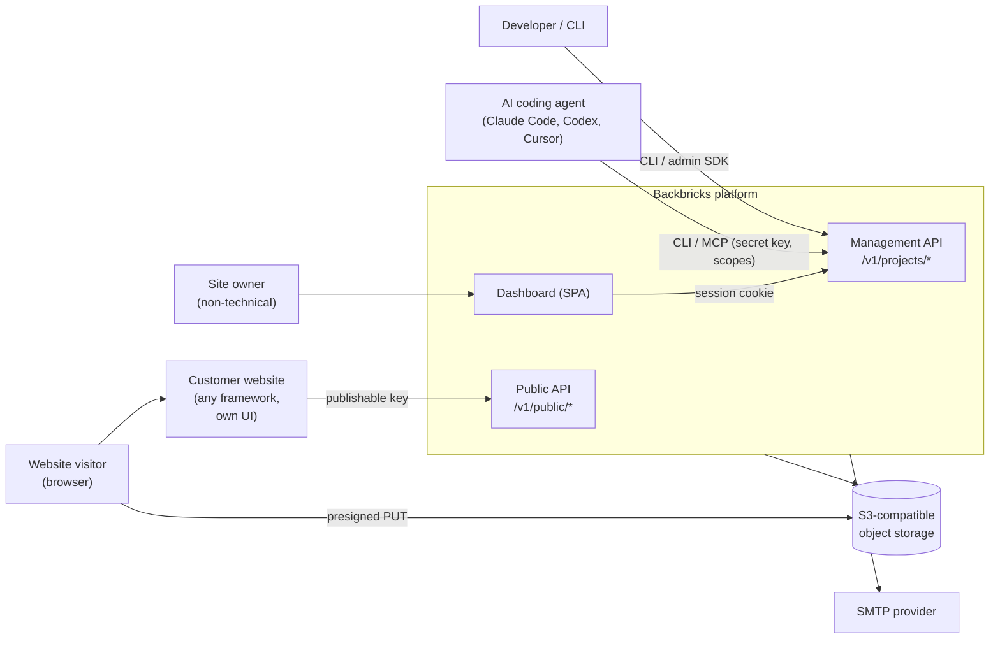
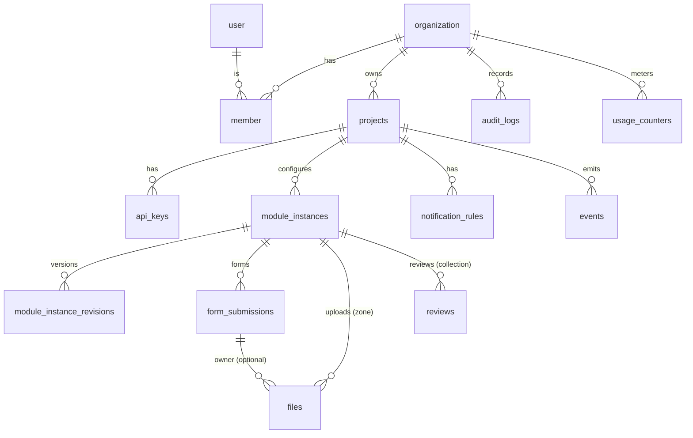
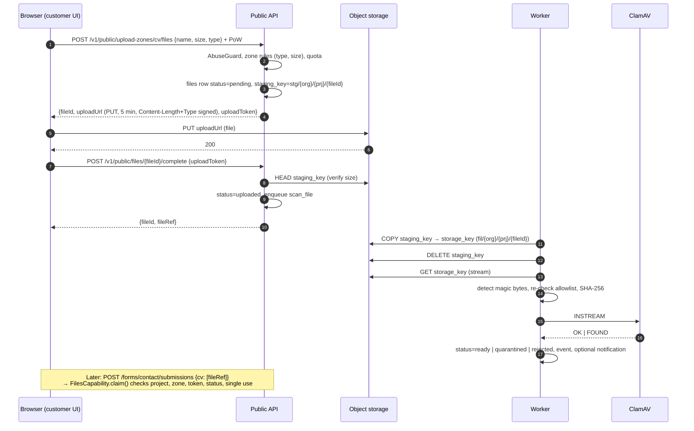

# Backbricks – Architecture

> **Backbricks** is an open-source, self-hostable headless platform that gives any website managed backend features (forms, file uploads, reviews), integrated by AI coding agents via API, SDK, CLI and MCP, and managed by non-technical site owners in a dashboard. A managed EU cloud follows after the open-source 1.0.
>
> *Backbricks are the backend bricks of a website: pick the ones you need and build any frontend on top. Backbricks carries the functionality; the website keeps its own look.*
>
> **Naming:** packages `@backbricks/*`, CLI `backbricks`, key prefixes `bb_pk_` / `bb_sk_`, config file `backbricks.config.json`. Project domain: `backbricks.app`.
> **Authority:** This document says *what* we build and how the parts fit. The *why* of each key decision lives in its ADR (`docs/adr/`); deviations are recorded there too. Engineering rules and invariants: `/AGENTS.md`. Roadmap: `docs/MILESTONES.md`. Cloud-only topics: `docs/CLOUD.md`.
> **Once built, code wins.** Sections that specify something not yet implemented (e.g. the SQL in §B.3) are replaced by a link to the code when it lands.

---

## 0. Key decisions at a glance

| # | Decision | Choice | ADR |
|---|---|---|---|
| 1 | System style | **Modular monolith**, one Docker image, process roles (`serve`, `worker`, …) | [0002](adr/0002-modular-monolith.md) |
| 2 | Language / runtime | **TypeScript 7, Bun** (runtime, package manager, test runner, bundler); Node only for Playwright and compatibility tests | [0003](adr/0003-typescript-and-bun.md) |
| 3 | Tooling | **mise**, **Turborepo**, **oxlint** (type-aware) + **oxfmt**, **lefthook** | [0004](adr/0004-tooling.md) |
| 4 | HTTP framework | **Hono** on `Bun.serve` + `@hono/zod-openapi` | [0005](adr/0005-hono-and-zod-openapi.md) |
| 5 | Dashboard | **React SPA (Vite)**, TanStack Router/Query, shadcn/ui, Tailwind v4, served by the API process | [0006](adr/0006-dashboard-spa.md) |
| 6 | Database | **PostgreSQL 18**, Drizzle ORM (`pg` driver); also queue and rate limits | [0007](adr/0007-postgresql-and-drizzle.md) |
| 7 | Background jobs | **pg-boss** (no Redis) | [0008](adr/0008-pg-boss.md) |
| 8 | File storage | **S3-compatible** behind an interface; self-host default **Garage** | [0009](adr/0009-s3-storage-and-garage.md) |
| 9 | Dashboard auth | **Better Auth** (email/password, organizations; later OAuth provider for remote MCP) | [0010](adr/0010-better-auth.md) |
| 10 | Multi-tenancy | Shared schema, `organization_id` + `project_id` on every row, `withTenant()`; Postgres RLS as second line (cloud) | [0011](adr/0011-multi-tenancy.md) |
| 11 | Public abuse protection | Publishable key + rate limits + honeypot + self-hosted **proof-of-work (ALTCHA)** + quotas | [0012](adr/0012-public-abuse-protection.md) |
| 12 | Uploads | Presigned **PUT** to object storage, signed size/type, **copy-then-scan**, private by default | [0013](adr/0013-presigned-uploads-copy-then-scan.md) |
| 13 | Agent integration | REST + OpenAPI, SDK, CLI with **config-as-code**, **stdio MCP inside the CLI**; remote MCP later | [0014](adr/0014-agent-integration.md) |
| 14 | Local development | **Docker Compose** for the whole dev environment; the same file in CI | [0015](adr/0015-docker-compose-dev-environment.md) |
| 15 | License | **AGPL-3.0-only** platform, **MIT** SDK/CLI/examples/skills, **DCO**, trademark policy | [0016](adr/0016-licensing.md) |
| 16 | Self-host vs. cloud | **Same code**, `DEPLOYMENT_MODE=self_hosted\|cloud`, differences only via injected interfaces | [0017](adr/0017-self-host-and-cloud-same-code.md) |
| 17 | Priority | **Open-source release first** (M0–M6), managed cloud afterwards (C1–C3) | [0018](adr/0018-open-source-first.md) |
| 18 | Module selection | **Every module is optional** (`BACKBRICKS_MODULES`); infrastructure derived from enabled modules (§C.7) | [0019](adr/0019-optional-modules.md) |

---

## 1. Assumptions and scope

**Assumptions** (re-evaluate if they stop holding):

- A1: Small initial load (< 100 organizations, < 1M submissions/month). One app instance plus one worker is enough.
- A2: One project equals one website. Test/live environments per project are out of MVP scope; test data is flagged with `is_test`.
- A3: Max file size in the MVP: 100 MB per file (single PUT). Multipart uploads come later.
- A4: Dashboard languages: English and German from day one (i18n keys); more later.
- A5: Review ratings use a 1–5 scale by default, configurable up to 10.
- A6: The website operator is the GDPR controller; the managed cloud acts as processor. Self-hosters are their own controllers and processors.

**Out of scope for v1:** visual website builder; drag-and-drop form designer with its own design engine; general-purpose CRM or CMS; auth-as-a-service for website end users; workflow automation builder; third-party module marketplace; email marketing infrastructure; payments/subscriptions for connected websites; native mobile SDKs; enterprise SSO.

**After v1:** candidate modules and the platform capabilities they need: `docs/MODULES.md`. Deferred technical topics: §J.3.

---

## A. Architecture

### A.1 Modular monolith and process roles

One TypeScript codebase with separated domain modules (`forms`, `uploads`, `reviews`) on a shared `core`, shipped as **one** Docker image (`oven/bun` base) that starts in one of these roles:

- `serve`: HTTP (public API, management API, Better Auth routes, static dashboard)
- `worker`: pg-boss jobs (malware scan, email, outbox dispatcher, retention, cleanup, usage aggregation)
- `all`: `serve` and `worker` in one process, for the smallest self-hosted setups (app + Postgres)
- `migrate`: one-shot database migrations
- `setup`: first-run setup (instance admin) for self-hosting (arrives in P6)

Module boundaries are enforced technically (§C.3), so a later extraction (e.g. the scan worker) stays possible. The marketing and docs site is a separate static Astro app (`apps/www`, ADR-0001).

### A.2 System context



### A.4 Communication paths

| From → To | Channel | Auth |
|---|---|---|
| Customer website → public API | HTTPS JSON (or `application/x-www-form-urlencoded` for plain HTML forms) | Publishable key (`bb_pk_…`) via `Authorization: Bearer` or `?key=` |
| Browser → object storage | Presigned PUT (5 min, size and type signed) | Signature in URL |
| Dashboard → management API | Same-origin fetch, the same API agents use (dogfooding) | Better Auth session cookie + CSRF header |
| CLI / MCP / backend → management API | HTTPS JSON | Secret key (`bb_sk_…`) with scopes |
| Customer backend → public API | HTTPS JSON | Secret key with `forms:submit` etc. (skips proof-of-work) |
| App → worker | Insert into `events` (outbox) or `pg-boss.send()` in the same transaction | internal |
| Worker → ClamAV | TCP `INSTREAM` | Network isolation |

### A.5 Infrastructure components

| Component | Required | Self-host default | Cloud |
|---|---|---|---|
| App (`serve`) | Yes | container | 1 instance (stateless, horizontally scalable later) |
| Worker | Yes (own container, or in-process via role `all`) | container (same image) | 1 instance |
| PostgreSQL | Yes (the only always-required service) | `postgres:18` | see `docs/CLOUD.md` |
| Object storage | Only if an enabled module needs files (Uploads) | Garage, compose profile `storage` | see `docs/CLOUD.md` |
| SMTP | Recommended (notifications; without SMTP, invitations fall back to copyable links) | any SMTP | EU SMTP provider |
| ClamAV | Optional, only with Uploads (`SCANNER=none\|clamav`) | compose profile `scan` | on |
| Reverse proxy/TLS | Recommended | Caddy | Caddy |
| Redis, CDN | No | – | only with measured need (§J.3) |

Dashboard authentication runtime: [ADR-0026](adr/0026-dashboard-auth-runtime.md). Organization roles, constrained invitation signup and missing-SMTP links: [ADR-0027](adr/0027-organization-policy-and-invitations.md), with linked code as the source of truth. Development's public URL points to Vite, which proxies the API; production auth requires HTTPS.

---

## B. Data model

### B.1 Principles

1. **Every tenant table** has `organization_id` and, if project-scoped, `project_id`. Exceptions: Better Auth tables and global system tables.
2. **IDs** are TypeIDs stored as `text` (prefix + UUIDv7 in base32, e.g. `sub_01jc9…`): sortable by time, self-describing in logs, and agents notice immediately when they pass the wrong kind of ID. Generated in the application.
3. **Module-specific tables** instead of a universal `records` table. User-defined fields live as `jsonb` inside module tables; fixed semantics (rating, moderation status, file status) are real columns with indexes.
4. **Personal data is hard-deleted** (no soft delete). Configuration objects may be archived. M1 project removal archives configuration and disables access; personal-data erasure is a separate workflow required before M2 release (ADR-0030).
5. **`expires_at`** on personal records and audit, derived from retention; transient auth/delivery records use bounded expiry (the library's equivalent field where applicable). Active identities/memberships and notification recipients follow their removal/erasure lifecycle rather than arbitrary account expiry. Daily maintenance hard-deletes expired records; lifecycle categories are defined in [ADR-0022](adr/0022-personal-data-lifecycles.md).
6. **IP addresses are never stored in clear text**, only as `HMAC-SHA256(ip, daily rotating key)` for rate limiting and abuse detection. Implementation and trusted-proxy rules: [ADR-0025](adr/0025-abuse-identity-and-rate-limits.md); `TRUSTED_PROXIES` is empty by default.
7. **Configuration is versioned** (`config_version`); every change creates a revision. Submissions record the version they were validated against.

### B.2 Entities and relationships



Hierarchy: **Organization → Project (= website) → Module instance (form `contact`, upload zone `cv`, review collection `testimonials`) → Records**.

### B.3 PostgreSQL schema (first version)

> **Code is authoritative for implemented tables.** Uploads and reviews SQL remains a spec until P3/P4 replaces it with schema links.

Better Auth tables (`user`, `session`, `account`, `verification`, `organization`, `member`, `invitation`) are implemented in the [generated auth schema](../packages/db/src/schema/auth.generated.ts) and the [central migration history](../packages/db/migrations/). Regenerate with `bun run auth:generate`, then `bun run db:generate` and review the resulting SQL. The [schema-only config](../packages/auth/auth.config.ts) has no database connection or import of its own generated output (ADR-0021). All tables specified below belong to the platform.

Implemented core tables are defined in code (ADR-0023), with no parallel SQL spec:

- [Projects and API keys](../packages/db/src/schema/projects.ts)
- [Module instances and revisions](../packages/db/src/schema/instances.ts)
- [Events, audit, notification rules and usage](../packages/db/src/schema/platform.ts)
- [Idempotency, rate limiting, replay and system settings](../packages/db/src/schema/technical.ts)
- [Forms entries](../packages/db/src/schema/forms.ts) (`form_submissions`; repository interface in the [forms module](../packages/modules/forms/src/repository.ts), ADR-0055)
- [Custom audit/membership/UNLOGGED constraints](../packages/db/migrations/20261106024528_audit_immutability/migration.sql)

Live child references include organization/project/instance identity; audit IDs are historical references retained without cascading FKs. Platform timestamps are supplied through the injected clock. Expiry/lifecycle rules follow ADR-0022. The SQL below specifies only the unimplemented domain tables.

```sql
-- =========================================================
-- Module: uploads
-- =========================================================
CREATE TABLE files (
  id                 text PRIMARY KEY,                     -- file_…
  organization_id    text NOT NULL,
  project_id         text NOT NULL,
  instance_id        text NOT NULL REFERENCES module_instances(id) ON DELETE CASCADE, -- upload zone
  status             text NOT NULL CHECK (status IN
                       ('pending','uploaded','scanning','ready','quarantined','rejected')),
  staging_key        text NOT NULL UNIQUE,                 -- target of the presigned URL
  storage_key        text UNIQUE,                          -- final copy, never writable via URL
  original_name      text NOT NULL,
  declared_mime      text,
  detected_mime      text,
  size_bytes         bigint NOT NULL CHECK (size_bytes > 0),
  sha256             bytea,
  scan               jsonb,                                -- {engine, result, signature, scanned_at}
  upload_token_hash  bytea NOT NULL,                       -- authorizes complete + claim
  owner_type         text,                                 -- 'form_submission' | 'review' | NULL
  owner_id           text,
  metadata           jsonb NOT NULL DEFAULT '{}',          -- client-provided, validated and bounded
  is_test            boolean NOT NULL DEFAULT false,
  subject_email      text,
  created_at         timestamptz NOT NULL DEFAULT now(),
  uploaded_at        timestamptz,
  expires_at         timestamptz
);
CREATE INDEX files_list_idx    ON files (instance_id, created_at DESC);
CREATE INDEX files_owner_idx   ON files (owner_type, owner_id) WHERE owner_id IS NOT NULL;
CREATE INDEX files_orphan_idx  ON files (created_at) WHERE owner_id IS NULL;
CREATE INDEX files_expiry_idx  ON files (expires_at) WHERE expires_at IS NOT NULL;

-- =========================================================
-- Module: reviews
-- =========================================================
CREATE TABLE reviews (
  id                 text PRIMARY KEY,                     -- rev_…
  organization_id    text NOT NULL,
  project_id         text NOT NULL,
  instance_id        text NOT NULL REFERENCES module_instances(id) ON DELETE CASCADE, -- collection
  rating             smallint NOT NULL CHECK (rating BETWEEN 1 AND 10),
  title              text,
  body               text,
  author_name        text NOT NULL,
  author_email       text,                                 -- never public
  public_fields      jsonb NOT NULL DEFAULT '{}',          -- e.g. company, role (public per config)
  private_fields     jsonb NOT NULL DEFAULT '{}',
  moderation_status  text NOT NULL DEFAULT 'pending' CHECK (moderation_status IN ('pending','approved','rejected')),
  published_at       timestamptz,
  moderated_by       text,
  moderated_at       timestamptz,
  spam_verdict       text NOT NULL DEFAULT 'ok' CHECK (spam_verdict IN ('ok','suspect','spam')),
  is_test            boolean NOT NULL DEFAULT false,
  source             jsonb NOT NULL DEFAULT '{}',
  created_at         timestamptz NOT NULL DEFAULT now(),
  updated_at         timestamptz NOT NULL DEFAULT now(),
  expires_at         timestamptz,
  CHECK (published_at IS NULL OR moderation_status = 'approved')
);
CREATE INDEX reviews_public_idx ON reviews (instance_id, published_at DESC)
  WHERE moderation_status = 'approved' AND published_at IS NOT NULL AND is_test = false;
CREATE INDEX reviews_queue_idx  ON reviews (instance_id, moderation_status, created_at DESC);
```


### B.4 Generic vs. module-specific

| Generic (core) | Module-specific |
|---|---|
| `projects`, `api_keys`, `module_instances`, `module_instance_revisions` | `form_submissions` |
| `events`, `audit_logs`, `notification_rules`, `usage_counters` | `files` |
| `idempotency_keys`, `rate_limit_buckets`, `pow_challenges_used`, `system_settings` | `reviews` |

**Rule of thumb:** whatever every module needs in the same shape (configuration, versioning, audit, events, notifications, usage) is generic. Anything with its own semantics, indexes or lifecycle is module-specific. A universal EAV/`records` table is deliberately **not** built; that road leads to a no-code database product.

### B.5 Migrations and schema versioning

- **One migration history** (`packages/db/migrations/`), generated with `drizzle-kit generate`, reviewed by hand and committed. Module tables, their migrations and repository implementations live in `packages/db`; the module declares the repository interface ([ADR-0055](adr/0055-module-tables-in-db.md)).
- **Forward-only** in production. Breaking changes follow *expand → migrate → contract* across two releases.
- `migrate` holds a Postgres advisory lock. In compose it runs as a one-shot service before `serve`/`worker`.
- **Module config formats:** `module_version` per instance. Modules ship deterministic `migrateConfig(fromVersion, config)` hooks. [Lazy reads](../packages/core/src/instances/persistence.ts) migrate only the returned view and disclose `storedModuleVersion`; explicit writes persist a new audited revision (ADR-0041). A deployment job uses the same persistence path.
- **Form schema evolution:** every change creates `config_version + 1` and a revision. Submissions store `config_version`; the dashboard renders each submission with the field definitions of its version and shows unknown/removed fields under "Additional data". CSV export uses the union of all fields.

### B.6 Tenant isolation in the data layer

- **Approved authentication bootstrap exception (I1 / Q10/Q11):** [exact credential hash lookup](../packages/db/src/repositories/credential-bootstrap.ts) returns only active key/organization/project IDs before a tenant is known. It exposes no unscoped metadata/query endpoint; trusted factories fix the secret/publishable kind and all subsequent access uses `withTenant` (ADR-0034/0054).
- **Access layer:** every request creates a `TenantContext { organizationId, projectId?, principal, scopes }`. Tenant tables are accessed only through `withTenant(ctx, async (tx) => …)`, which
  1. opens a transaction,
  2. sets `app.org_id` / `app.project_id` as transaction-local settings (prepares RLS),
  3. returns repositories whose queries are always scoped by `organization_id`/`project_id`.
- Implemented boundary: [`createWithTenant`](../packages/db/src/with-tenant.ts), [core repository contracts](../packages/core/src/tenancy/repositories.ts) and [db repositories](../packages/db/src/repositories/). Contexts are trusted snapshots, handles expire with the transaction, and domain callbacks receive no raw driver (ADR-0024). Auth principal/scope middleware is added in P1.3b/P1.4c; the repository boundary itself does not authorize callers.
- **Resources of other tenants return `404`**, never `403` (no existence leaks).
- **Enforced by:** an architecture rule against direct table access outside repositories, and the isolation suite: fixtures with 2 organizations × 2 projects; for **every** registered management route, credentials of B on resources of A must return `404`. Object keys are prefixed with org/project; download URLs are only issued after DB authorization.
- **Cloud phase:** Postgres RLS as second line of defense (`docs/CLOUD.md`).

---

## C. Module architecture

### C.1 Module contract

The implemented contract is [`ModuleDefinition`](../packages/core/src/modules/contract.ts), normalized by [`defineModule`](../packages/core/src/modules/define-module.ts); see [ADR-0037](adr/0037-static-module-contracts.md) for the refinements to the initial sketch. It owns typed configuration/defaults/templates/migrations/change classification, localized metadata, resource names, scopes/events/metrics, declared infrastructure/services/capabilities, route/job registration, retention/privacy, notification and codegen hooks. Schemas must have representable JSON output. Changed configurations without a classifier are conservatively destructive.

Routes use the framework-neutral [router contract](../packages/core/src/modules/routes.ts), with Zod inputs, response allowlists, explicit policies/body limits and public read/write classification. [Jobs](../packages/core/src/modules/jobs.ts) declare a typed payload, retries and bounded retention. [ADR-0039](adr/0039-module-http-and-worker-wiring.md) defines the implemented [HTTP bridge](../apps/server/src/routes/modules.ts), [worker hand-off](../apps/server/src/module-jobs.ts) and merged scope catalog. Public authorization uses the shared guard (ADR-0046). Durable job delivery uses the [PostgreSQL queue adapter](../packages/db/src/queue.ts) with atomic enqueue/completion and shared process lifetimes ([ADR-0048](adr/0048-transactional-postgres-jobs.md)). The server owns HTTP/auth/OpenAPI/worker wiring; module code imports only the public core contract and its own files. M1 proves complete definitions with [test-only modules](../packages/db/test/module-fixtures.ts); forms/uploads/reviews become operational in M2–M4.

### C.2 Registration

Static, no runtime plugins. `apps/server/src/modules.ts` lists the modules. [`defineRegistry`](../packages/core/src/modules/registry.ts) validates unique types/resources/scopes/events/metrics/providers/routes/jobs, satisfied required capabilities, dependency cycles and module namespaces, and orders providers before consumers. Required infrastructure/services fail during binding; absent optional providers are null. The dashboard has a parallel static registry (`apps/web/src/modules/registry.ts`) with nav entries, routes and icons per module.

**Generic features the core provides for every module** (no module code needed):

- [Instance CRUD](../packages/core/src/instances/service.ts) (`GET/POST /v1/projects/{id}/{plural}`, `GET/PATCH/DELETE …/{key}`) incl. config validation, revision, audit log and event; PATCH/DELETE require the current config version, DELETE archives configuration and requires destructive permission (ADR-0040)
- Viewing and rolling back revisions
- Config-as-code document `GET/PUT /v1/projects/{id}/config` (all instances of all modules)
- JSON Schema export for editor autocompletion
- Notification rules on module events; delivery asks the optional `notifications.describe` hook what a mail may say ([ADR-0059](adr/0059-notification-rules-and-dispatch.md), [ADR-0060](adr/0060-notification-delivery-and-throttling.md))
- Retention cron, GDPR access/erasure via `retention`/`privacy` handlers
- Usage metering

### C.3 Module boundaries and data isolation

- A module imports **only** `@backbricks/core` and its own files (enforced by dependency-cruiser).
- A module receives only its own scoped repository (interface declared by the module, implemented in `packages/db`, ADR-0055) and an opaque `TenantHandle`. It reads/writes **only its own tables**, plus generic core tables through bound core services; it never receives platform repositories or the full transaction.
- **Cross-module collaboration happens via capabilities.** Example: `forms` needs files; `uploads` provides the `files` capability:
  ```ts
  interface FilesCapability {
    claim(tx: TenantHandle, input: { refs: FileRef[]; zoneKey: string; owner: { type: string; id: string }; maxFiles: number }): Promise<ClaimedFile[]>;
    listByOwner(tx: TenantHandle, owner: { type: string; id: string }): Promise<FileSummary[]>;
    deleteByOwner(tx: TenantHandle, owner: { type: string; id: string }): Promise<void>;
  }
  ```
  `forms` calls `ctx.capabilities.optional('files')?.claim(ctx.tx, …)` in **the same transaction** that stores the submission.

### C.4 Shared services (injected by the core)

| Service | Responsibility | Implementations |
|---|---|---|
| `db` / `withTenant` | Tenant-bound transactions | Drizzle/Postgres |
| `audit` | Audit entry in the same transaction | Postgres |
| `events` | Outbox insert in the same transaction | Postgres |
| `queue` | Enqueue jobs | pg-boss |
| `storage` | presign PUT/GET, HEAD, copy, delete, stream | S3 (AWS SDK v3) |
| `scanner` | Malware scan of a stream | `none`, `clamav` |
| `mailer` | Templated mail | SMTP (nodemailer); dev: Mailpit |
| `abuseGuard` | Pipeline for public writes | honeypot, PoW (`altcha-lib`), origin, rate limit, heuristics |
| `rateLimiter` | Fixed window / token bucket | Postgres (UNLOGGED table), memory |
| `usage` | Increment counters | Postgres |
| `entitlements` | Check limits/quotas | `unlimited` (self-host), `plans` (cloud) |
| `clock`, `ids` | Testable time, TypeIDs | – |

Implemented [service container](../packages/core/src/services/container.ts), [usage](../packages/core/src/services/usage.ts), [entitlements](../packages/core/src/services/entitlements.ts) and [provider ports](../packages/core/src/services/providers.ts) are the source of truth (ADR-0035). [Server composition](../apps/server/src/services.ts) owns shared runtime lifetimes. Module views enforce declared provider access and never expose an unbound tenant selector or raw driver.

### C.5 Example: a hypothetical fourth module "Waitlist"

Goal: visitors join a waitlist with email (and an optional referral code) with double opt-in.

```
packages/modules/waitlist/
  src/config.ts        # zod: { doubleOptIn, confirmRedirectUrl, fields, retentionDays }
  src/repository.ts    # repository interface (augments ModuleRepositories); table + implementation in packages/db (ADR-0055)
  src/public.ts        # POST /v1/public/waitlists/{key}/entries, GET …/confirm?token=
  src/admin.ts         # list, export, delete (uses core helpers for pagination/CSV)
  src/jobs.ts          # send confirmation mail
  src/privacy.ts       # exportSubject/deleteSubject by email
  src/index.ts         # export const waitlistModule: ModuleDefinition<WaitlistConfig>
apps/web/src/modules/waitlist/   # list + settings pages, registry entry
packages/db/src/schema/waitlist.ts, repositories/waitlist.ts, migrations/…  # table, repository, generated migration
apps/server/src/modules.ts       # one line: add waitlistModule
```

**What does not change:** core tables, auth, keys, audit, notifications (rule on `waitlist.entry.confirmed`), CLI (config-as-code learns `waitlists` from the registry), MCP (generic `config_*` tools), SDK (the generic `client.request('waitlists', key, 'entries', body)` works immediately; a typed `waitlists.join()` is optional sugar).

### C.6 Deliberately not built

- No runtime plugin loading, no marketplace
- No generic workflow engine (notification = rule "event → email"; webhooks later = rule "event → URL")
- No user-defined tables or relations

### C.7 Optional modules and minimal deployments

Every module can be switched on or off per installation. A self-hoster who only needs uploads runs only what uploads needs.

- **Implemented M1 availability:** [ADR-0038](adr/0038-module-catalog-and-availability.md) and the [catalog](../packages/core/src/modules/catalog.ts) distinguish selected descriptors from operational definitions. `/v1/meta` and project integration metadata expose only this safe availability projection. Domain descriptors become operational in M2–M4.
- **One image, runtime selection.** All modules ship in the same image; `BACKBRICKS_MODULES=uploads` (comma-separated, default: all) decides which are active. Enabling a module later is an env change plus a restart, no rebuild.
- **Filtered registry.** `defineRegistry` registers only enabled modules: their routes, jobs, scopes, events, MCP tools and dashboard navigation. Disabled modules are inert.
- **Dependencies are validated at startup.** Unsatisfied hard `requires` fail startup with a clear message (nothing in v1 hard-requires another module). `optional` capabilities degrade gracefully: without Uploads, the forms field type `file` is unavailable and configs using it are rejected with `capability_unavailable`.
- **Infrastructure is derived, not assumed.** Each module declares `infrastructure` (`storage`, `scanner`, …). The core composes the env schema from the enabled modules: S3 variables are required only if a module needs storage; ClamAV only if Uploads runs with `SCANNER=clamav`. `/readyz` checks only the services that are actually needed.
- **Disabled modules in the API.** Their routes aren't mounted; requests get `404` with code `module_not_enabled` and a hint. `GET /v1/meta` (public) and `GET /v1/projects/{id}/integration` list enabled modules, so dashboard, SDK, CLI and MCP adapt automatically. Pushing config for a disabled module fails validation.
- **Migrations stay one history.** All tables are created regardless of selection, so enabling a module later needs no special migration ordering, and disabling one never deletes data.
- **Compose profiles follow the selection.** `deploy/compose` uses profiles per infrastructure (`storage` for Garage, `scan` for ClamAV). A `configure` step asks which modules to enable and writes `BACKBRICKS_MODULES` plus the matching `COMPOSE_PROFILES` into `.env`.

| Enabled modules | Containers (self-hosted) | Notes |
|---|---|---|
| Forms and/or Reviews | app (`all`) + postgres (+ caddy) | No object storage, no ClamAV; ~512 MB RAM total |
| Uploads | app + worker + postgres + garage (+ clamav) (+ caddy) | ClamAV (~1.5–2 GB RAM) only if scanning is wanted |
| All v1 modules | app + worker + postgres + garage + clamav + caddy | Full setup |

**Cloud:** all modules are enabled at the instance level. Per-organization availability (e.g. by plan) is handled by `entitlements`, not by `BACKBRICKS_MODULES`.

---

## D. API, SDK, CLI and MCP

The [committed contract](../packages/api-contract/openapi.json) and [generated types](../packages/api-contract/src/generated.ts) come from the shared [runtime registrations](../apps/server/src/routes/platform.ts). `bun run api:generate` runs offline; the [MIT admin entry](../packages/sdk/admin/index.ts) imports only contract types ([ADR-0051](adr/0051-offline-contract-and-admin-client.md)).

### D.1 Authentication model

| Credential | Format | Used in | May | May not |
|---|---|---|---|---|
| **Publishable key** | `bb_pk_<32 chars base62>` | Public website code | Public API of its project | Management API; reading data (except published reviews) |
| **Secret key** | `bb_sk_<32 chars base62>` | Servers, CLI, MCP, CI | Management API per scopes; public API without PoW | Be used from a browser (detected and blocked) |
| **Session** | Better Auth cookie (`HttpOnly`, `Secure`, `SameSite=Lax`) | Dashboard | Everything per role | Cross-origin requests |
| **OAuth access token** (later) | JWT/opaque | Remote MCP | Granted scopes | – |

**Secret key in browser detection:** a request with a secret key **and** an `Origin` header other than the dashboard origin gets `403 secret_key_exposed`; the incident is audited and owners/admins receive an email recommending rotation.

**Scopes (secret keys):**

Implemented management principal/selector/permission behavior: [ADR-0028](adr/0028-management-principals-and-permissions.md), with linked core schemas and server composition as the source of truth. Production [key resolution](../packages/core/src/keys/authentication.ts) and [server delivery composition](../apps/server/src/key-auth.ts) implement scoped lookup, audited exposure rejection and throttled notification intent (ADR-0034).

The implemented [scope catalog and presets](../packages/core/src/keys/scopes.ts) are the source of truth (ADR-0031). Issuance rejects unknown/disabled-module grants. The agent preset excludes personal-data and destructive/deletion rights. [Key material](../packages/core/src/keys/material.ts) separates the one-time credential from hashed secret persistence; [management metadata](../packages/core/src/keys/metadata.ts) never redisplays a secret.

Keys are created exclusively through owner/admin dashboard sessions. [Key management routes](../apps/server/src/routes/keys.ts) and the [core service](../packages/core/src/keys/service.ts) enforce this at both boundaries; list responses never redisplay secrets (ADR-0032). No key can create keys.

### D.2 Resource structure and URL conventions

**Base:** `https://api.<domain>/v1` (cloud: dedicated subdomain for the public API; self-host: same host, path `/v1`).

**Public API** (publishable key):

| Method | Path | Purpose |
|---|---|---|
| `GET` | `/v1/public/challenge` | Proof-of-work challenge (ALTCHA format) |
| `GET` | `/v1/public/forms/{formKey}` | Public schema (fields, required, limits, PoW needed?) |
| `POST` | `/v1/public/forms/{formKey}/submissions` | Submit (JSON, or urlencoded with 303 redirect) |
| `POST` | `/v1/public/upload-zones/{zoneKey}/files` | Upload intent → `{fileId, uploadUrl, headers, uploadToken, expiresAt}` |
| `POST` | `/v1/public/files/{fileId}/complete` | Complete upload (with `uploadToken`) |
| `GET` | `/v1/public/review-collections/{key}/reviews` | Published reviews (cursor, `sort=newest\|rating_desc\|rating_asc`, `limit≤50`) |
| `GET` | `/v1/public/review-collections/{key}/stats` | Count, average, distribution |
| `POST` | `/v1/public/review-collections/{key}/reviews` | Submit a review |

**Management API** (session, secret key):

| Area | Paths |
|---|---|
| Projects | `GET/POST /v1/projects`, `GET/PATCH/DELETE /v1/projects/{projectId}` |
| Keys (session only) | `GET/POST /v1/projects/{id}/keys`, `DELETE …/keys/{keyId}` |
| Config-as-code | `GET /v1/projects/{id}/config`, `PUT …/config?dryRun=true\|false` (response: plan/diff, warnings, `planHash`) |
| Types | `GET /v1/projects/{id}/types?lang=ts` |
| Integration | `GET /v1/projects/{id}/integration` (base URL, publishable key, origins, snippets) |
| Forms | `…/forms`, `…/forms/{key}`, `…/forms/{key}/revisions`, `…/forms/{key}/submissions`, `…/submissions/{id}`, `POST …/submissions/bulk`, `GET …/forms/{key}/export.csv` |
| Uploads | `…/upload-zones`, `…/upload-zones/{key}`, `…/files`, `…/files/{id}`, `POST …/files/{id}/download-url`, `POST …/files/bulk-delete`, `GET …/storage-usage` |
| Reviews | `…/review-collections`, `…/review-collections/{key}`, `…/reviews`, `PATCH …/reviews/{id}` (approve/reject/publish/unpublish), `DELETE …/reviews/{id}` |
| Platform | `…/notification-rules`, `…/audit-logs`, `…/usage`, `POST …/privacy/subject-export`, `POST …/privacy/subject-delete` |
| Organization (session only) | `/v1/organizations/{orgId}/…` for members, audit, billing |

**Conventions:** plural, kebab-case path segments; module instances addressed by `key`, records by TypeID; cursor pagination (`?cursor=&limit=`, response `{ data, nextCursor }`); `PATCH` uses JSON Merge Patch; public `POST`s accept `Idempotency-Key`.

### D.3 Error format

RFC 9457 problem details with agent-friendly extensions:

```json
{
  "type": "https://backbricks.app/errors/validation_failed",
  "title": "Validation failed",
  "status": 422,
  "code": "validation_failed",
  "detail": "2 fields are invalid.",
  "errors": [
    { "path": "email", "code": "invalid_email", "message": "Must be a valid email address." },
    { "path": "message", "code": "too_long", "message": "Must be at most 5000 characters.", "meta": { "max": 5000 } }
  ],
  "hint": "Fetch the form schema via GET /v1/public/forms/contact to see all constraints.",
  "requestId": "req_01jc…"
}
```

Stable `code` values are part of the API contract (catalog in `packages/core/src/errors/codes.ts`).

### D.4 API versioning

- Route policy and HTTP registration are implemented in [`route-policy.ts`](../packages/core/src/http/route-policy.ts) and [`ApiRoutes`](../apps/server/src/http/api-routes.ts). Every `/v1/*` operation declares access, body size and (for management) an isolation case; the runtime guard detects handlers bypassing registration. Health/static routes are outside `/v1`; Better Auth uses its separate inventoried surface and transaction boundary (ADR-0021). The generated document is served at `/v1/openapi.json`; committed type generation/drift checks arrive in P1.11b/c.
- Major version in the path (`/v1`); within v1 additive changes only (I17).
- The [OpenAPI artifact](../packages/api-contract/openapi.json) is generated from the Zod routes and committed. [Drift checks](../scripts/api/check.ts) compare without overwriting edits; [compatibility checks](../scripts/api/breaking.ts) compare the actual PR base (local merge-base otherwise), allowing bootstrap only for a real base with no contract. Both gates run in check/pre-push/CI. [ADR-0052](adr/0052-contract-gates-and-method-handling.md) defines authorization-safe 405 handling and extensible RFC 9457 code/status documentation.
- Deprecations get `Deprecation`/`Sunset` headers and a changelog entry; minimum 6 months.
- Module config formats are versioned via `module_version`; the config file via `$schema` (`config.v1.json`).

### D.5 Secure direct browser integration

Assumption: an attacker knows the publishable key and every form key and can send arbitrary requests without a browser. Protection therefore relies on **cost, limits and damage reduction**, not secrecy.

**AbuseGuard pipeline** for every public write (cheap before expensive):

Implemented transport, instance context, schema-read limits, project-bound redirects and HTML error behavior: [ADR-0046 and its P2 addenda](adr/0046-public-write-guard-and-cors.md). Plain HTML support is an explicit module-route opt-in; configuration and response code are the source of truth.

1. Key valid, project active, instance active (else `404`)
2. Body limit (forms 64 KB, reviews 16 KB, upload intent 4 KB)
3. Rate limits: `ip_hash × instance` (default 10/min, 100/h), `project` (default 600/min), global
4. Origin check if `allowed_origins` is set (convenience and signal, **not** a security boundary)
5. Honeypot field (configurable name) → pretend `200 OK` and drop
6. Proof-of-work (if enabled on the instance; default **on**): HMAC-signed challenge, 10 min expiry, single use (`pow_challenges_used`)
7. Schema validation (server-side, strict, unknown fields rejected)
8. Heuristics: link count, repetition, suspicious patterns → `spam_verdict = suspect|spam` (spam goes to a spam folder and is auto-deleted after 30 days, never silently lost)
9. Quotas/entitlements (cloud): monthly limit, storage limit → `402 quota_exceeded`
10. Persist + event + usage in one transaction

Origin validation and exact matching live in [`origins.ts`](../packages/core/src/http/origins.ts). Project write payloads use [`project schemas`](../packages/core/src/projects/schemas.ts); settings currently accept only the empty reserved object until typed settings are introduced. Management routes and their permissions live in [`project routes`](../apps/server/src/routes/projects.ts); lifecycle/audit logic lives in the [core service](../packages/core/src/projects/service.ts) (ADR-0030).

The implemented [shared guard](../packages/core/src/abuse/guard.ts), [policy schemas](../packages/core/src/abuse/policy.ts) and [public host executor](../apps/server/src/public-executor.ts) follow [ADR-0046](adr/0046-public-write-guard-and-cors.md). JSON transport wraps module data in `{data, proof?, honeypot?}`; the module schema remains the sole domain payload contract.

Public write routes can opt into the [shared idempotency helper](../packages/core/src/abuse/idempotency.ts), with one-day, tenant/project-bound acknowledgement caching in the domain transaction ([ADR-0047](adr/0047-atomic-public-idempotency.md)). Matching committed retries replay before proof consumption; changed requests conflict.

**CORS:** public routes reflect `Origin` when it is in `allowed_origins` (if the list is empty: "all", with a warning in the dashboard). Management routes have **no** CORS.

### D.6 Upload flow



- **Copy-then-scan:** the scan runs on a copy under a key for which no presigned URL was ever issued, so a still-valid upload URL cannot overwrite an already scanned file.
- Object keys **never** contain the original file name.
- Dashboard downloads: presigned GET, 60 s, `response-content-disposition=attachment`, `response-content-type=application/octet-stream`. Inline preview only for detected `image/png|jpeg|webp|gif`, **never SVG/HTML**. Every download is audited (`files.downloaded`).
- `pending` and unclaimed files are deleted automatically after 24 h.
- **Self-host without publicly reachable storage:** `UPLOAD_MODE=proxy` streams uploads through the app with a hard size limit. Default is `presigned`.

### D.7 TypeScript SDK

| Package | License | Contents |
|---|---|---|
| `@backbricks/sdk` | MIT | Browser/server, dependency-free, ESM, < 8 KB gz (without PoW solver); `forms`, `uploads`, `reviews`, generic `request()`. Runs on browsers, Node ≥ 20, Bun, Deno |
| `@backbricks/sdk/pow` | MIT | PoW solver (web worker), lazy-loaded |
| `@backbricks/sdk/admin` | MIT | Typed management client generated from OpenAPI (`openapi-fetch`); also used by the dashboard |
| `@backbricks/react` (later) | MIT | Unstyled hooks `useForm`, `useUpload`, `useReviews` |

```ts
const backbricks = createClient({ publishableKey: import.meta.env.PUBLIC_BACKBRICKS_KEY });
const cv = await backbricks.uploads.upload(file, { zone: 'cv', onProgress: (p) => setProgress(p.percent) });
await backbricks.forms.submit('contact', { name, email, message, cv: [cv.ref], privacy: true }); // throws BackbricksError
const { data, nextCursor } = await backbricks.reviews.list('testimonials', { sort: 'newest', limit: 10 });
```

`backbricks codegen` generates form types so `forms.submit('contact', …)` is typed (module augmentation of a `BackbricksSchema` interface).

Implemented so far (M2): the minimal root entry in [`packages/sdk/src`](../packages/sdk/src) (`createClient` needs `baseUrl` until a hosted default exists; publishable keys travel as `?key=`), see [ADR-0062](adr/0062-minimal-sdk-snippets-and-release-version.md).

### D.8 CLI

`npx backbricks <command>` (package `backbricks`, MIT, bundled with `bun build --target=node` so it runs on Node ≥ 20 and Bun). Every command supports `--json`, runs non-interactively with `--yes`, and has documented exit codes.

| Command | Purpose |
|---|---|
| `backbricks login [--key bb_sk_…]` | Store a secret key (`~/.config/backbricks/credentials`, mode 0600, or env `BACKBRICKS_SECRET_KEY`); later: browser device flow |
| `backbricks init [--project prj_…]` | Link a local project: writes `backbricks.config.json`, adds the publishable key to `.env.local` under a framework-appropriate name, updates `.gitignore`, optionally appends an `AGENTS.md` section |
| `backbricks pull` | Write the remote config to `backbricks.config.json` |
| `backbricks diff` | Show the plan (local vs. remote), destructive changes highlighted |
| `backbricks push [--allow-destructive]` | Apply the plan (two-step: dry run → `planHash` → apply) |
| `backbricks validate` | Validate the config file locally against its JSON Schema |
| `backbricks codegen [--out src/backbricks.gen.ts]` | Generate TypeScript types |
| `backbricks test submit forms/contact --data '{…}'` | Test submission (`is_test`) |
| `backbricks doctor` | Checks connectivity, origins, keys; scans for `bb_sk_` in public env prefixes (`NEXT_PUBLIC_`, `VITE_`, `PUBLIC_`, `NUXT_PUBLIC_`) and build output |
| `backbricks docs [--agent]` | Print the integration guide as Markdown |
| `backbricks mcp` | Start the MCP server over stdio |
| `backbricks keys list` | List keys (metadata only) |

**Config-as-code** (`backbricks.config.json`) uses the implemented [document schema](../packages/core/src/configuration/schemas.ts) and [pure planner](../packages/core/src/configuration/planner.ts), following ADR-0042. Root fields are `$schema`, `project` and `modules`; sections use each module's declared plural resource name. Every instance has an explicit name/status/module-version/config-version envelope around its module-owned `config`. Existing instances require the current config-version precondition. Notification recipients, credentials and personal records are excluded. Omitted sections preserve state; explicit empty sections request destructive configuration archival. No production domain configuration is implemented in M1.

**Field types in the MVP:** `text`, `textarea`, `email`, `phone`, `number`, `url`, `select`, `multiselect`, `checkbox`, `date`, `hidden`, `file`, `consent`. Validations: `required`, `minLength`/`maxLength`, `min`/`max`, `options`. **No custom regex** (ReDoS risk, I10).

### D.9 MCP server

**MVP:** `backbricks mcp` starts a stdio MCP server (official TypeScript MCP SDK) inside the CLI, authenticated with the secret key from env/credentials. Setup in Claude Code: `claude mcp add backbricks -- npx backbricks mcp`. Remote MCP with OAuth is a later option (`docs/CLOUD.md`).

| Tool | Scope | Behavior |
|---|---|---|
| `project_info` | `integration:read` | Base URL, publishable key, origins, module overview |
| `config_get` | `config:read` | Current config document |
| `config_plan` | `config:read` | Desired config → diff, warnings, `planHash` |
| `config_apply` | `config:write` | Applies **only** a previously planned `planHash`; destructive changes require `config:destructive` |
| `form_upsert`, `upload_zone_upsert`, `review_collection_upsert` | `config:write` | Convenience wrappers (plan + apply internally) |
| `types_generate` | `config:read` | TS declarations |
| `integration_guide` | `integration:read` | Framework-specific guide + snippets (`nextjs`, `astro`, `vue`, `html`, …) |
| `origins_add` | `project:write` | Add allowed origins |
| `test_submit` | `test:write` | Test submission incl. response |
| `stats_get` | `stats:read` | Counts without personal data |

**Security boundaries:** no delete tools, no reading of personal data in the default preset, no key management. Every change is audited with `actor_type='mcp'` and can be rolled back via revisions. Tool descriptions contain no secrets.

### D.10 Scenario A: an agent integrates a contact form, upload and reviews

1. The site owner signs up, creates project "example.com" and a key with preset "AI agent / CLI" (shown once).
2. The owner asks the coding agent for "a contact form with CV upload and testimonials" and provides `BACKBRICKS_SECRET_KEY` locally.
3. `backbricks init --project prj_…` reads `/integration` and writes `backbricks.config.json` and `.env.local` (`PUBLIC_BACKBRICKS_KEY=bb_pk_…`).
4. The agent extends the config (`forms.contact`, `uploadZones.cv`, `reviewCollections.testimonials`) and runs `backbricks push --yes` (dry run → plan → apply with `planHash`).
5. `backbricks codegen`, then the agent builds its own UI components with `@backbricks/sdk`.
6. `backbricks test submit forms/contact` creates a test entry (secret key, `is_test`); `backbricks doctor` confirms no secret key in public variables.
7. The owner sees the test entry in the dashboard, adds a notification email and confirms the origin.

The P5 end-to-end test automates this scenario.

### D.11 Documentation for humans and agents

- `docs/` as Markdown in the repo (source), rendered with Astro Starlight at `backbricks.app/docs` inside `apps/www` (ADR-0001)
- `llms.txt` and `llms-full.txt` at the docs root
- Agent skill `skills/backbricks/SKILL.md` (integration flow, rules like "never put secret keys in frontend code", error codes, per-framework examples)
- `backbricks docs --agent` provides the same guide offline
- API reference from OpenAPI (Scalar) at `/docs/api`

---

## E. Dashboard

Account screens use the [public Better Auth client](../apps/web/src/auth/client.ts) and generated admin client with same-origin cookies/CSRF, safe redirects, ephemeral reset tokens and en/de copy ([ADR-0053](adr/0053-dashboard-account-boundary.md)). Public [account capabilities](../apps/server/src/routes/meta.ts) derive from the guarded server configuration; they expose availability only.

### E.1 Information architecture

```
[Organization ▾] / [Project ▾]                         [Help] [Account]
│
├─ Project
│  ├─ Overview           New since last visit, recent activity, usage, integration status
│  ├─ Inbox (Forms)      List of forms → Entries | Fields | Settings | Embed
│  ├─ Files (Uploads)    All files | Upload areas | Storage
│  ├─ Reviews            To review | Published | Rejected | Stats | Embed
│  ├─ Embed              Keys, allowed domains, "Connect an AI agent", snippets, test status
│  └─ Settings           General | Notifications | Privacy & retention | Danger zone
│
└─ Organization
   ├─ Projects
   ├─ Members            Invite, roles
   ├─ Activity log       (audit log)
   ├─ Billing & usage    (cloud only)
   └─ Settings
```

The [authenticated shell](../apps/web/src/dashboard/shell.tsx) uses the live session’s organization, cancels/removes tenant queries before switching, and keys project queries by organization/project with an explicit organization header. Project forms use the generated admin client; empty allowed-origin lists require an explicit warning acknowledgement. M1 renders only operational module availability and mounts no domain pages.

Modules add themselves to the navigation through the web registry. Wording is deliberately non-technical ("Inbox"/"Entries" instead of "Submissions", "Embed" instead of "API").

The [Embed screen](../apps/web/src/dashboard/embed.tsx) submits generated key contracts directly, outside mutation/query caches, and clears the creation token on dismissal or navigation. Only owner/admin sessions render key management; member integration reads remain safe. [Shared dialogs](../packages/ui/src/components/key-reveal-dialog.tsx) take translated copy and handle clipboard failure without logging values.

[Members](../apps/web/src/dashboard/members.tsx) uses only the guarded public organization client, with owner/admin gates, explicit role/removal confirmation and translated last-owner errors. The no-SMTP fallback is rendered only from an authorized creation response, validates the local invitation URL and is cleared on dismissal. [Activity](../apps/web/src/dashboard/activity.tsx) paginates the scoped audit API and renders structural event/role data only.

### E.2 Module dashboards

| Module | Main view | Detail | Actions |
|---|---|---|---|
| Forms | Table: date, key fields (configurable), status, unread dot, attachment icon; filters: status, date range, spam, search | Drawer with all fields rendered by type, attachments, metadata | Mark read/open/done, delete, CSV export (admin), spam/not spam |
| Uploads | Table/grid: name, type, size, status (scanning / ready / quarantined), owner | Preview (safe image types), metadata, scan result | Download, delete, multi-select, storage meter |
| Reviews | Moderation queue (cards), keyboard shortcuts A/R | Full text, author, private fields | Approve, reject, publish/unpublish, delete; stats with average and distribution |

### E.3 Reusable UI components (`packages/ui`, shadcn-based)

`DataTable` (TanStack Table, server pagination, filter bar, multi-select), `RecordDrawer`, `FieldValue` (renders every field type safely), `StatusBadge`, `EmptyState` (with embed hint and snippet), `ConfirmDialog` (type-to-confirm for bulk deletes), `RetentionPicker` ("6 months" instead of "180 days"), `FieldListEditor` (list with up/down, field-type picker, templates, **no** drag-and-drop designer), `SnippetTabs` (HTML/JS/React/Next/Astro), `StarRating`, `FileThumb`, `UsageMeter`, `KeyRevealDialog`.

### E.4 Roles and permissions (MVP)

| Action | Owner | Admin | Member |
|---|:-:|:-:|:-:|
| View entries, files, reviews; set status; download | ✔ | ✔ | ✔ |
| Moderate reviews | ✔ | ✔ | ✔ |
| Delete single records | ✔ | ✔ | ✔ |
| Bulk delete, CSV export | ✔ | ✔ | ✘ |
| Configure forms/zones/collections | ✔ | ✔ | ✘ |
| Keys, origins, notifications, retention | ✔ | ✔ | ✘ |
| Manage members | ✔ | ✔ (not owners) | ✘ |
| Billing, delete organization, transfer ownership | ✔ | ✘ | ✘ |

Roles are organization-wide. Per-project access comes later (a `project_access` table can be added).

### E.5 UX principles for non-technical owners

1. **Sensible defaults:** PoW on, retention 6 months, notifications without content, files private
2. **Templates instead of empty pages:** contact form, quote request, job application, event sign-up, testimonials
3. **Hide the technical parts:** keys, JSON and revisions live under "For developers"
4. **Human language and times:** "3 hours ago", "CV.pdf (2.1 MB)"
5. **Safe destructiveness:** deletes explain consequences; bulk deletes require typing the form name
6. **"Connect an AI agent" wizard:** creates a preset key and a ready-to-copy prompt block for Claude Code/Codex
7. Mobile-friendly entry and moderation views (owners often read inquiries on their phone)

---

## F. Security and privacy

### F.1 Security measures

Beyond the invariants in AGENTS.md §3:

| Layer | Measure |
|---|---|
| Transport | TLS 1.2+ via Caddy, HSTS, no clear-text ports exposed |
| Storage | Provider disk encryption; object storage server-side encryption; encrypted backups |
| Secrets | SHA-256 only (high-entropy tokens need no slow hash); env-based app secrets; credential field/value masking at the final JSON log boundary; request IDs, route templates and problem serialization prevent diagnostic leaks (ADR-0033) |
| Sessions | Better Auth, `HttpOnly`/`Secure`/`SameSite=Lax`, CSRF header required for mutating dashboard requests, login rate limits |
| Output | CSV injection protection: prefix `'` before `= + - @ \t \r` |
| Exfiltration | Export only for owner/admin, audited and rate limited; `data:read` not in the agent preset; page size max 100 |
| Dependencies | Lockfile, Dependabot, `bun audit` in CI, minimal runtime deps, non-root containers with read-only file system |
| Headers | Strict CSP, `X-Content-Type-Options`, `Referrer-Policy`, `Permissions-Policy`, `frame-ancestors 'none'` for the dashboard |

### F.2 Tenant isolation

See §B.6 and invariants I1–I3.

### F.3 Malware scanning

- ClamAV (`clamd`) as an optional container with `freshclam` updates; needs roughly 1.5–2 GB RAM
- Scan via `INSTREAM`; `StreamMaxLength` matches the max file size
- `FOUND` → `quarantined`, object deleted, metadata kept, admin notification; scan errors → retry, `rejected` after 3 failures
- `SCANNER=none` (self-host option): files become `ready` but the dashboard marks them "not scanned for malware"
- ClamAV does not catch everything; the real protection is the combination of allowlist, magic bytes, private storage and forced download

### F.4 Privacy and deletion

| Mechanism | Implementation |
|---|---|
| Retention | `retentionDays` per instance (default 180; 7–3650 or "unlimited" with a warning); `expires_at` on insert, recomputed on change, daily purge (DB + objects), summarized audit entry |
| Spam | Auto-deleted after 30 days |
| Access (Art. 15 GDPR) | Search by email across modules (`privacy.exportSubject`, `POST …/privacy/subject-export`) → JSON (files as ZIP from M3), audited |
| Erasure (Art. 17 GDPR) | `privacy.deleteSubject` across modules incl. files via `POST …/privacy/subject-delete` (job), audited (without content or email) |
| Minimization | IP only as rotating HMAC; user agent only as family; notifications without content by default; no tracking cookies |
| Consent | `consent` field type stores text version and timestamp |
| Removing projects | Configuration archive disables access immediately (ADR-0030); the owner then erases an archived project by typing its slug. A worker erases every module through `privacy.eraseScope`, platform rows and queued job payloads, and keeps a tombstone for audit references ([ADR-0061](adr/0061-project-hard-erasure.md)). No restore endpoint |
| Deleting organizations | Disabled until the complete audited hard-erasure lifecycle exists; hard, cascading, objects via job; confirmation by typing the name |
| Backups | Deleted data disappears when backup rotation expires (30 days), disclosed in the privacy documentation |

### F.5 Backup and restore (self-host)

- Bundled backup container (`pg_dump` + `restic` to any target) and a documented restore guide
- CI job: dump → restore → smoke test
- Cloud backups (PITR, offsite, drills): `docs/CLOUD.md`

### F.6 Audit logging

Logged: member and role changes, key creation/revocation, config changes (changed field paths and revision numbers; values stay in authorized revision reads), exports, downloads, deletions (single and bulk), GDPR requests, secret-key exposure, retention runs. Committed logins emit a metadata-only operational signal before organization selection; no account-level login history is claimed ([ADR-0027](adr/0027-organization-policy-and-invitations.md)). **Not** logged: submission content or readable actor/key labels. Tenant audit logs are append-only (trigger), kept for 1 year, filterable and exportable in the dashboard.

The [activity services and metadata schemas](../packages/core/src/services/activity.ts) write through the caller's scoped repositories, never a second transaction. Audit retention is one year; outbox metadata expires after 30 days. Payloads are structural metadata/identifiers/counters only; token-bearing email delivery is a separate restricted lifecycle (ADR-0022). The [dispatcher](../packages/core/src/jobs/outbox.ts) and [restricted mail queue](../packages/db/src/queue-mail.ts) provide atomic fan-out and bounded, retryable auth/security delivery ([ADR-0049](adr/0049-outbox-and-restricted-delivery.md)); the [worker maintenance capability](../packages/db/src/repositories/maintenance.ts) and [durable scheduling](../packages/db/src/queue-schedules.ts) provide bounded absolute-expiry cleanup and selected module fan-out ([ADR-0050](adr/0050-bounded-worker-maintenance.md)). [Platform read routes](../apps/server/src/routes/platform-reads.ts) and [query contracts](../packages/core/src/queries/schemas.ts) supply scoped activity, usage and safe integration metadata (ADR-0036); expired audit entries are hidden before pagination.

---

## G. Repository, self-hosting and open source

### G.1 Repository structure

```
apps/{server,web,www}/               # API + worker roles · dashboard SPA · marketing/docs site (ADR-0001)
packages/{core,db,auth,adapters}/    # contracts + pure logic · Drizzle + withTenant · Better Auth · S3/SMTP/ClamAV/…
packages/modules/{forms,uploads,reviews}/
packages/{api-contract,sdk,cli,ui}/  # generated OpenAPI · SDK (MIT) · CLI + MCP (MIT) · shared UI
cloud/                               # cloud only: plans, billing adapter (C1)
examples/{nextjs,astro,html}/  skills/backbricks/   # MIT
compose.yaml                         # dev environment, also used by CI
deploy/compose/                      # production self-host compose, Caddyfile, .env.example (P6)
docs/{adr,progress,guides,security}/
```

Dependency directions between these: AGENTS.md §2.1.

### G.3 License

AGPL-3.0-only for `apps/*`, `packages/{core,db,auth,adapters,modules,ui,api-contract}`, `cloud/`; **MIT** for `packages/sdk`, `packages/cli`, `examples/*`, `skills/*` (customer websites never embed AGPL code). Contributions under **DCO**; if dual licensing is ever wanted, switch to a CLA before the first external contribution. The registered **trademark** protects the cloud. Details: `LICENSING.md`, `TRADEMARKS.md`, ADR-0016. Legal review before 1.0.

### G.4 Self-hosting (Docker Compose)

Services: `caddy` (TLS, routes the app and, if needed, the storage domain), `app` (`serve`), `worker`, `migrate` (one-shot), `postgres:18`, `garage` (profile `storage`), `clamav` (profile `scan`), `backup` (profile `backup`, `pg_dump` + `restic`).

1. Run the `configure` step (or fill `.env` from `.env.example` by hand): choose modules (`BACKBRICKS_MODULES`), domain, `APP_SECRET`, DB password, optional SMTP; S3 settings only if a selected module needs storage. It sets `COMPOSE_PROFILES` to match (§C.7)
2. `docker compose up -d` starts only the services the selected modules need (plus `--profile backup` if wanted)
3. If storage is enabled, `garage-init` creates bucket, key and CORS rule (one-shot)
4. `migrate` runs before `app`/`worker` (`depends_on: condition: service_completed_successfully`)
5. A setup wizard on first visit creates the instance admin; afterwards sign-up is invite-only by default (`SIGNUP_POLICY=invite_only`)

**Configuration** only via environment variables, validated with Zod at startup (clear error, exit). Docker secrets via `*_FILE` variants. **Updates:** semver-tagged images, `docker compose pull && docker compose up -d`, migrations run automatically; breaking changes only in majors with an upgrade guide. **Telemetry:** off, optional opt-in.

### G.5 Self-hosted vs. cloud

| Aspect | Self-hosted | Cloud |
|---|---|---|
| Code | identical | identical + `cloud/` package |
| Organizations | any number (agencies) | any number |
| Sign-up | setup wizard, then invite-only (configurable) | open, email verification required |
| Limits | `UnlimitedEntitlements` | `PlanEntitlements` |
| Billing | – | billing adapter |
| Malware scan | optional | on |
| RLS | optional | on |
| Telemetry | off | internal metrics |

The difference is wired at startup via `DEPLOYMENT_MODE` and dependency injection (`entitlements`, `billing`, `signupPolicy`). **There are no `if (cloud)` branches in modules** (I15). Cloud details: `docs/CLOUD.md`.

### G.7 What is open source

**Everything essential to run it:** all modules in full, teams and roles, audit log, retention, GDPR tools, exports, CLI, MCP, SDK, later webhooks. **Cloud-exclusive** is only what makes sense in managed operation: billing and plans, operated scanning, backups, monitoring, email delivery, DPA and support. Paid business features (SSO/SAML, longer audit retention, multiple regions) are decided only once there are paying customers.

---

## H. Technology choices

Rationale and alternatives: the ADRs in §0. Pinned versions: `PLAN.md` → version list. Version rule: AGENTS.md §10 (check current versions, pin exactly, read the docs instead of guessing).

| Area | Choice |
|---|---|
| Tools & tasks, monorepo | mise · Bun workspaces + Turborepo |
| Runtime, language | Bun · TypeScript 7 (a tool may pin an older `typescript` locally, ADR-0020) |
| Lint, format, architecture rules, hooks | oxlint (type-aware) · oxfmt · dependency-cruiser · lefthook |
| HTTP, validation | Hono + `@hono/zod-openapi` · Zod 4 |
| DB, ORM, jobs | PostgreSQL 18 · Drizzle (`pg` driver, shared with pg-boss) · pg-boss |
| Auth | Better Auth (+ organization; later oauth-provider) |
| Storage | AWS SDK v3 S3 client + presigner behind `StorageAdapter` · Garage for self-hosting |
| Malware, anti-bot | ClamAV (clamd) · ALTCHA protocol via `altcha-lib` |
| Mail, logging | nodemailer (SMTP), templates as TS functions, Mailpit in dev · pino (JSON) with request IDs |
| Dashboard | Vite, React 19, TanStack Router + Query, shadcn/ui, Tailwind v4, react-hook-form, i18next |
| Tests | `bun test` (+ Testing Library, happy-dom) · Playwright · fast-check |
| API docs, website | Scalar · Astro + Starlight on Vercel (ADR-0001) |
| MCP, code intelligence | official TypeScript MCP SDK (stdio) · CodeGraph |
| CI, proxy | GitHub Actions (`jdx/mise-action`), GHCR, npm provenance · Caddy |

---

## I. Roadmap

Milestones, scope, exit criteria and effort: `docs/MILESTONES.md`. Tasks: `PLAN.md`.

---

## J. Risks and critical decisions

### J.1 Top risks

| # | Risk | Mitigation |
|---|---|---|
| 1 | **Abuse of public endpoints** (spam, storage abuse, malware hosting, cost explosion) | AbuseGuard, PoW, quotas, private files, forced download, scanning |
| 2 | **Cross-tenant data leak** (existential) | `withTenant`, 404 policy, isolation suite over all routes, RLS |
| 3 | **Scope creep** towards CMS, no-code DB or workflow engine | Fixed module contract, out-of-scope list, ADR required for new core concepts |
| 4 | **Solo-founder ops burden** (DB, backups, on-call) | Minimal services, cloud only after 1.0, managed-DB option (`docs/CLOUD.md`) |
| 5 | **Processor liability** (DPA, TOMs, breaches) | Early legal review, data minimization, audit, notification process |
| 6 | **Competition** (Formspree, Basin, UploadThing, Supabase/Pocketbase, testimonial tools, AI builders with bundled backends) | Agent-native + EU + open source + non-technical dashboard + several modules from one place |
| 7 | **Secret key leaks by agents** and destructive agent changes | Scopes and presets, browser detection, `doctor`, plan/apply, no delete tools, revisions |
| 8 | **Unstable API contract** with websites you don't control | Contract-first, additive-only, drift checks, deprecation policy |
| 9 | **License choice**; relicensing without CLA impossible | AGPL core + MIT clients, DCO, trademark, decide before the first external PR |
| 10 | **Toolchain maturity** (Bun compatibility, oxfmt 0.x, TS 7 ecosystem, S3/ClamAV) | Library spike (ADR-0020), storage contract tests, tool-local fallbacks |

### J.2 Get right from the start (expensive to change)

1. `organization_id`/`project_id` on every tenant table and `withTenant` as the access path, with only the approved authentication hash/ID bootstrap exception (I1, ADR-0034/0054)
2. ID format (TypeID as `text`)
3. Public vs. management API separation and the key model (publishable/secret + scopes)
4. Module contract, config-as-code format with `$schema`/`module_version`, revisions
5. Upload model: presigned, private by default, copy-then-scan
6. Error format and codes as API contract; `/v1` additive-only
7. Postgres as the only stateful core dependency; one image, multiple roles
8. Privacy defaults: IP hashing, `expires_at`, hard delete, content-free notifications
9. Client package license (MIT) and contribution model (DCO/CLA) before the first external contribution
10. Interfaces for every external service (storage, mailer, scanner, captcha, billing)
11. Module optionality: the core and every module work with any subset of enabled modules; infrastructure requirements are declared per module (§C.7)

### J.3 Deliberately deferred

| Topic | When | Prepared now |
|---|---|---|
| Billing provider | C2 | `BillingProvider` interface |
| RLS enforcement | C1 | transaction-local settings in `withTenant` |
| Remote MCP with OAuth 2.1 (`/mcp`, Streamable HTTP) | C3 / later | Scopes, stdio MCP |
| Webhook delivery (signatures, retries, logs) | post-1.0 OSS | `events` outbox |
| Multipart/resumable uploads (tus), image variants | on demand | storage interface |
| Several `serve` instances, workers split by queue | measured need | stateless app, pg-boss queues |
| Redis/Valkey rate limiter, CDN for the review read API, more EU regions | measured need | interfaces, correct cache headers (`Cache-Control`, `ETag`) |
| Schema-per-tenant for enterprise | enterprise demand | shared-schema scoping in repositories |
| Per-project permissions, SSO | customer demand | central role checks |
| Application-level field encryption | enterprise demand | data access encapsulated in repositories |
| Test/live environments per project | post-1.0 | `is_test`, extensible key prefixes |
| `@backbricks/react` hooks | post-1.0 | framework-neutral SDK core |
| More dashboard languages | post-1.0 | i18n keys from day one |

---

*Changes to decisions in §0 or §J.2 require an ADR.*
