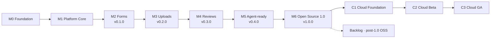

# Milestones

**Priority: the open-source project comes first.** The open-source track (M0–M6) ends with `v1.0.0`, a self-hostable release that is genuinely useful on its own. The managed cloud track (C1–C3) starts only after M6.

- Tasks per phase: `PLAN.md`; acceptance of a phase = the exit criteria of its milestone below
- Architecture: `docs/ARCHITECTURE.md`; cloud background: `docs/CLOUD.md`
- GitHub milestones are created from `.github/milestones.json` with `mise run gh:milestones` (idempotent; titles and one-line summaries only, this file holds the detail)

Effort is in person-days (PD, 8 h) for one experienced developer working with AI coding agents, including tests and reviewing agent output. At 15–20 h/week, calendar time grows by roughly 2–2.5×. The original roadmap allowance to 1.0 was **≈ 57–73 PD**; detailed phase estimates and the revised total are maintained in [`PLAN.md`](../PLAN.md#overview). Cloud afterwards: **≈ 15–21 PD**.

## Versioning policy

- `0.x` releases are developer previews: APIs, config format and DB schema may change between minors (with migration notes).
- From `v1.0.0`: semantic versioning, `/v1` API additive-only, config format versioned via `$schema`, forward-only DB migrations, breaking changes only in majors with an upgrade guide.
- Every release: changelog (Changesets), signed Git tag, Docker image on GHCR; npm packages from M5 on.

---

## Open-source track

### M0 · Foundation · ✅ done
- **Phase:** P0 · **Effort:** 4–5 PD original allowance (detailed estimate in PLAN) · **Release:** – · **Report:** [`progress/phase-0.md`](progress/phase-0.md) · [CI green, merged PR #4](https://github.com/nolliebigspin/backbricks/pull/4)
- **Goal:** A runnable, tested skeleton every later phase builds on.
- **Scope:** workspace packages, architecture rules (dependency-cruiser), Docker Compose dev environment (infra + app services), env config, server/worker/migrate entry points, Drizzle + migration runner, dashboard skeleton reusing `packages/ui` (shadcn theme and components, already created with the website, ADR-0001), dependency-cruiser rule that `apps/www` imports only `packages/ui`, production Dockerfile, CI completion, library spike on Bun/TS 7.
- **Exit criteria:**
  - `mise run setup && mise run dev` starts infra, server, worker and dashboard
  - `bun run check` green locally and in CI on a PR against `main`
  - Docker image serves `/healthz` and the dashboard
  - pre-push hook active; CodeGraph index builds

### M1 · Platform Core
- **Phase:** P1 · **Effort:** 12–15 PD original allowance; [detailed plan and proposed revised estimate](../PLAN.md#phase-p1--platform-core-m1--planned-2026-11-06) · **Release:** –
- **Goal:** A multi-tenant platform with every contract in place, but no domain modules yet.
- **Scope:** Better Auth (orgs, roles, invitations), core schema, `withTenant`, API keys + scopes, projects, module registry + capabilities, generic instance CRUD + config-as-code (plan/apply), services (audit, events, mailer, storage, rate limiter, usage, entitlements), AbuseGuard + PoW, worker + outbox, OpenAPI pipeline, dashboard shell, tenant isolation suite.
- **Exit criteria:**
  - Sign-up → org → project → keys → invite works end to end (Playwright)
  - Isolation suite covers 100 % of management routes
  - Audit entries visible for key and member actions
  - Secret key with foreign origin → `403` + audit entry
  - OpenAPI drift check enforced in CI

### M2 · Forms → `v0.1.0` (developer preview)
- **Phase:** P2 · **Effort:** 9–11 PD original allowance; [detailed plan and accepted revised estimate](../PLAN.md#phase-p2--forms-m2--v010--planned-2026-11-09)
- **Goal:** The first module, complete: a headless form backend plus a dashboard inbox.
- **Scope:** form config + templates, runtime validation, public submit (JSON + plain HTML), idempotency, spam handling, admin API (list, search, status, bulk, CSV), notifications, retention + GDPR handlers, dashboard inbox, minimal SDK `forms.submit`, HTML example.
- **Exit criteria:**
  - Plain HTML and fetch examples create entries visible in the dashboard
  - Validation errors are structured problem details
  - Spam/honeypot handled; notification arrives in Mailpit without content
  - CSV export is injection-safe (a field `=SUM(1)` is exported defused); expired entries are purged
  - Isolation suite covers the new routes
- **Release:** `v0.1.0` image + dev-setup quickstart in README

### M3 · Uploads → `v0.2.0`
- **Phase:** P3 · **Effort:** 9–12 PD
- **Goal:** Safe direct-to-storage uploads, linked to forms.
- **Scope:** upload zones, presigned PUT with signed size/type, copy-then-scan with ClamAV, magic-byte checks, `files` capability + form file fields, admin API + downloads, cleanup jobs, dashboard files view, SDK `uploads.upload`, storage contract suite.
- **Exit criteria:**
  - EICAR → `quarantined`, object deleted, notification sent
  - An upload larger than declared is rejected by storage; PDF extension with EXE content → `rejected`
  - A second PUT to the upload URL after `complete` doesn't change the final file
  - A foreign or already claimed `fileRef` → error
  - Downloads have `Content-Disposition: attachment`; orphans deleted after 24 h

### M4 · Reviews → `v0.3.0`
- **Phase:** P4 · **Effort:** 5–7 PD
- **Goal:** Collect, moderate and publish reviews; the first module that serves data publicly.
- **Scope:** collection config, submit, public list + stats with caching, moderation API, dashboard moderation queue, SDK methods.
- **Exit criteria:**
  - Only `approved` + published + `is_test=false` reviews are public
  - Snapshot tests prove email, private fields and `source` never appear in public responses
  - `If-None-Match` → `304`; stats match fixtures

### M5 · Agent-ready → `v0.4.0`
- **Phase:** P5 · **Effort:** 12–15 PD
- **Goal:** An AI coding agent can integrate all three modules without human help (scenario A).
- **Scope:** full SDK (+ admin client), CLI (`init`, `pull`, `diff`, `push`, `validate`, `codegen`, `test`, `doctor`, `docs`), stdio MCP server, agent skill, `llms.txt`, docs site (Starlight at `backbricks.app/docs` inside `apps/www`, plus `/errors/*` and `/schema/*`), examples (Next.js, Astro, HTML), "Connect an AI agent" wizard.
- **Exit criteria:**
  - Scenario A E2E green in CI
  - The MCP server registers in Claude Code and creates a form via `form_upsert`
  - `doctor` reports a key deliberately set as `NEXT_PUBLIC_BACKBRICKS_SECRET`
  - SDK < 8 KB gz; CLI works with `npx` (Node) and `bunx`; SDK tests pass on Node and Bun
- **Release:** npm packages `@backbricks/sdk` and `backbricks` published

### M6 · Open Source 1.0 → `v1.0.0`
- **Phase:** P6 · **Effort:** 6–8 PD
- **Goal:** A production-ready self-hostable release (scenario C) and a healthy open-source project.
- **Scope:** production compose (Caddy, Garage, ClamAV, backup) with module selection so only the needed services run, setup wizard, proxy upload mode, backup/restore, upgrade path, security hardening + threat model, SPDX headers and dependency license check, release pipeline, legal review of license/trademark docs.
- **Exit criteria:**
  - Fresh-VM install in < 30 min following the README; scenario C test green in CI
  - Minimal installs work: forms-only runs as app + Postgres; uploads-only runs without ClamAV
  - Restore test green; security header checklist satisfied
  - `v1.0.0` tagged; image and npm packages released

### Backlog · Post-1.0 OSS
Not scheduled; picked up based on community demand.

- **New modules and the platform capabilities they need:** see [`docs/MODULES.md`](MODULES.md) (single source; order validated with users after 1.0)
- **Platform improvements:** webhooks (delivery, signatures, retries), `@backbricks/react` headless hooks, multipart/resumable uploads, per-project permissions, test/live environments, more dashboard languages, optional captcha providers

---

## Managed cloud track (after M6)

### C1 · Cloud Foundation
- **Effort:** 7–9 PD
- **Scope:** `DEPLOYMENT_MODE=cloud` (open sign-up, onboarding), plans + entitlements + metering, Postgres RLS, infrastructure on Hetzner (DE) with PITR and offsite backups, deploy pipeline.
- **Exit criteria:** staging environment running; limits enforced; RLS tests green; backups verified.

### C2 · Cloud Beta
- **Effort:** 5–7 PD
- **Scope:** billing provider integration, monitoring/alerting/error tracking, runbooks (incident, breach, key rotation, restore), restore drill, load test, legal drafts (DPA, TOMs, sub-processors, privacy policy, terms), closed beta with first users.
- **Exit criteria:** restore drill recorded; billing webhooks tested; beta users onboarded.

### C3 · Cloud GA
- **Effort:** 3–5 PD
- **Scope:** legal sign-off, status page, public launch, scenario D E2E on production; optional remote MCP with OAuth 2.1.
- **Exit criteria:** paid plans live; legal documents published; public status page.
